# Transalp Bordcomputer

> Open-Source Bordcomputer fuer die Honda Transalp 600 (PD06) — basierend auf ESP32-S3, GPS, Dual-Display, direkter Sensor-Anzapfung und BLE-Smartphone-Integration.

[](LICENSE)
[](https://www.espressif.com/en/products/socs/esp32-s3)
[](https://docs.espressif.com/projects/esp-idf/)
[](docs/research/)
[](firmware/)
[](companion-app/)
[](docs/)
[](.github/workflows/)
[](docs/ROADMAP.md)
[-darkgreen.svg)](#)


---

## Uebersicht

Dieses Projekt dokumentiert den Bau eines vollstaendigen Open-Source Bordcomputers fuer die Honda Transalp 600 (PD06, Baujahr 1986–2000). Die PD06 ist eine rein mechanische Maschine ohne CAN-Bus, OBD-II oder elektronische Motorsteuerung. Alle Fahrzeugdaten werden ueber eigenstaendige Sensoren und direkte Signal-Anzapfung erfasst.

Das Projekt ist in fuenf Phasen gegliedert (0–4), die alle abgeschlossen sind:
**Recherche, Analyse, Design/Prototyp, Implementierung, Integration & Test.**
38 Tasks wurden von 6 Worker-Profilen abgearbeitet. Das Ergebnis ist 226.000+
Woertern Dokumentation, 15.000+ Zeilen Firmware-Code, eine React-Native-Companion-App
und 35 UI-Mockup-Prototypen.

### Kern-Features

| Bereich | Features |
|---|---|
| **Fahrzeugdaten** | Drehzahl (CDI-Pickup), Geschwindigkeit (Reed/Hall), Kuehlmitteltemperatur, Kraftstoffstand, Oeldruck, Ganganzeige, Bordspannung |
| **Dual-Display** | TFT (ILI9488, 480x320, 30 FPS) fuer Echtzeit-Telemetrie + E-Paper (2.13", monochrom) fuer sonnenlesbare statische Werte |
| **GPS-Tracking** | 10 Hz GPS, NMEA-Parser, GPX-Track-Export, Hoehenmeter, Touren-Statistiken |
| **Smartphone-Integration** | BLE-Verbindung zur Companion-App — Turn-by-Turn Navigation, Wetter, Anrufbenachrichtigungen, Musik-Steuerung |
| **Sensoren** | IMU (Neigung/Beschleunigung/Crash-Detection), Barometer (Hoehe), Umgebungstemperatur |
| **Steuerung** | Relais-basiert — Zusatzlicht, Heizgriffe, USB-Ladung |
| **Safety** | Crash-Erkennung mit automatischem Notfall-SOS, Diebstahl-Warnung |
| **Power-Management** | LiPo-Backup (18650, 3400 mAh), Deep-Sleep (~0.4 mA), Wake-on-Motion, automatische Zustandsuebergaenge |
| **Diagnose-System** | 16 DTC-Codes in 4 Kategorien, Self-Test beim Boot, Remote-Diagnose ueber BLE |
| **OTA-Update** | Firmware-Update ueber BLE/HTTP/SD mit Dual-Partition-Rollback und SHA-256-Verifikation |
| **Daten-Logging** | CSV-Telemetrie (5 Hz) + GPX-Tracks (1 Hz) auf MicroSD, NVS-Konfiguration |

---

## Getting Started

### Fuer Entwickler (Firmware)

```bash
# Repo klonen
git clone https://github.com/TitoPrausee/transalp-bordcomputer.git
cd transalp-bordcomputer

# ESP-IDF Umgebung aktivieren (v5.x)
. $IDF_PATH/export.sh

# Build
cd firmware
idf.py set-target esp32s3
idf.py build

# Flash + Monitor
idf.py -p /dev/cu.usbmodem* flash monitor
```

Voraussetzungen: ESP-IDF v5.x, Python 3.9+, Git.
Siehe [Firmware-Engineering-Guide](docs/FIRMWARE-GUIDE.md) fuer Architektur-Details,
[API-Reference](docs/API-REFERENCE.md) fuer das BLE GATT-Protokoll,
[Architektur](docs/ARCHITECTURE.md) fuer das System-Design.

### Fuer Bastler (Hardware)

1. **Stueckliste besorgen** — Siehe [BOM.md](docs/BOM.md) (alle Komponenten mit Preisen und Quellen) oder die kompakte [Einkaufsliste](docs/SHOPPING-LIST.md)
2. **PCB fertigen** — Siehe [PCB-Layout](docs/PCB-LAYOUT.md) fuer Layer-Stackup und Routing-Regeln
3. **Schaltplan verdrahten** — Siehe [Hardware.md](docs/HARDWARE.md) und [Pinmap](docs/PINMAP.md)
4. **Gehaeuse drucken** — Siehe [Gehaeuse-Design](docs/CASE-DESIGN.md) fuer 3D-Druck-Dateien
5. **Firmware flashen** — Siehe oben (Fuer Entwickler)
6. **Einbauen** — Siehe [Montage-Anleitung](docs/INSTALLATION-GUIDE.md) fuer PD06-spezifischen Einbau

### Fuer Nutzer (Endanwender)

1. **Bordcomputer einbauen** — Nach [Montage-Anleitung](docs/INSTALLATION-GUIDE.md)
2. **Companion-App installieren** — React-Native-App aus [companion-app/](companion-app/) bauen
3. **Per BLE verbinden** — App verbindet automatisch mit dem Bordcomputer
4. **Loslegen** — Telemetrie, Navigation, Diagnose und Track-Export in der App

Hilfe bei Problemen: [Troubleshooting-Guide](docs/TROUBLESHOOTING.md)
Bedienung: [Benutzerhandbuch](docs/USER-MANUAL.md)

---

## Systemarchitektur

```mermaid
graph TB
    subgraph Vehicle["Honda Transalp 600 PD06"]
        CDI["CDI-Zuendung<br>Pickup-Signal"]
        TACHO["Tachowelle<br>mechanisch"]
        TEMP["Kuehlmittel<br>Temperatursensor"]
        FUEL["Tankgeber<br>5-90 Ohm"]
        OIL["Oeldruckschalter"]
        LIGHT["Licht-Blinker<br>12V"]
    end

    subgraph Sensors["Sensor-Frontend"]
        OPT["Optokoppler<br>Galvanische Trennung"]
        IND["Induktivsensor<br>GT101 am Zuendkabel"]
        HALL["Hall-Sensor<br>am Vorderrad"]
        NTC["NTC 10kOhm<br>im Kuehlschlauch"]
        DIV["Spannungsteiler<br>fuer Tankgeber"]
        ADC_INTER["ADC-Interface<br>esp_adc_cal"]
    end

    subgraph MCU["ESP32-S3 Core Module"]
        CPU["Dual-Core 240MHz<br>16MB Flash, 8MB PSRAM"]
        RTOS["FreeRTOS<br>Task-Scheduler"]
        SPI_BUS["SPI Bus<br>Display + SD"]
        I2C_BUS["I2C Bus<br>IMU + BMP280"]
        UART_BUS["UART<br>GPS NEO-M9N"]
        BLE_STACK["NimBLE<br>GATT Server"]
    end

    subgraph Peripherals["Peripherie"]
        GPS["u-blox NEO-M9N<br>10Hz, 72-Kanal"]
        EPAPER["E-Paper 2.9 Zoll<br>296x128, Partial-Refresh"]
        TFT["TFT 2.4-3.5 Zoll<br>ILI9341-ILI9488"]
        IMU["MPU6050<br>Gyro + Accel"]
        BMP["BMP280<br>Temp + Baro"]
        SD["MicroSD<br>Class 10, FAT32"]
        RELAY["4-Kanal Relais<br>Zusatzlicht-Heizgriffe"]
    end

    subgraph Power["Power-Management"]
        BATT["LiPo 18650<br>3400mAh"]
        CHARGE["TP4056<br>USB-C Laden"]
        BOOST["MT3608<br>3.7V zu 5V"]
        LDO["HT7333<br>5V zu 3.3V"]
        MONITOR["ADC Akku-Ueberwachung"]
    end

    subgraph Smartphone["Smartphone Companion App"]
        APP["React Native<br>Companion App"]
        MAPS["Native Maps API"]
        NAV["Turn-by-Turn<br>Navigation Engine"]
        NOTIF["Notification Relay"]
        MEDIA["Now-Playing<br>Media Control"]
    end

    CDI --> OPT
    CDI --> IND
    TACHO --> HALL
    TEMP --> NTC
    FUEL --> DIV
    OIL --> OPT
    LIGHT --> OPT

    OPT --> CPU
    IND --> CPU
    HALL --> CPU
    NTC --> ADC_INTER
    DIV --> ADC_INTER
    ADC_INTER --> CPU

    GPS <-->|UART 38400| UART_BUS
    EPAPER -->|SPI| SPI_BUS
    TFT -->|SPI| SPI_BUS
    SD -->|SPI| SPI_BUS
    IMU -->|I2C 400kHz| I2C_BUS
    BMP -->|I2C 400kHz| I2C_BUS
    RELAY -->|GPIO| CPU

    BATT --> CHARGE
    BATT --> BOOST
    BOOST --> LDO
    LDO --> MCU
    LDO --> Peripherals
    BATT --> MONITOR
    MONITOR -->|ADC| CPU

    APP <-->|BLE GATT| BLE_STACK
    MAPS --> NAV
    NAV -->|Maneuver Data| BLE_STACK
    NOTIF -->|Caller-SMS| BLE_STACK
    MEDIA -->|Track Info| BLE_STACK

    RTOS --> CPU
    BLE_STACK --> CPU
    SPI_BUS --> CPU
    I2C_BUS --> CPU
    UART_BUS --> CPU

    style MCU fill:#1a1a2e,color:#e0e0e0,stroke:#578bfc,stroke-width:2px
    style Vehicle fill:#1a2a1a,color:#e0e0e0,stroke:#00fe40,stroke-width:2px
    style Power fill:#2a1a1a,color:#e0e0e0,stroke:#ff6b6b,stroke-width:2px
    style Smartphone fill:#1a1a2a,color:#e0e0e0,stroke:#578bfc,stroke-width:2px
    style Sensors fill:#2a2a1a,color:#e0e0e0,stroke:#ffd93d,stroke-width:1px
    style Peripherals fill:#1a2a2a,color:#e0e0e0,stroke:#4ecdc4,stroke-width:1px
```



### FreeRTOS Task-Modell

| Task | Core | Prioritaet | Stack | Rate | Beschreibung |
|---|---|---|---|---|---|
| `gps_task` | 1 | 5 | 4 KB | 10 Hz | NMEA-Parsing ueber UART, Position/Geschwindigkeit |
| `sensor_task` | 1 | 4 | 4 KB | 50 Hz | IMU + Barometer ueber I2C, gleitender Mittelwert |
| `vehicle_task` | 1 | 4 | 4 KB | 10 Hz | Drehzahl, Tacho, Temp, Kraftstoff, Oeldruck (ADC/Pulse) |
| `display_task` | 0 | 2 | 6 KB | 1 Hz | UI-Rendering auf E-Paper + TFT |
| `logger_task` | 0 | 3 | 4 KB | 5 Hz | SD-Karten-Logging (Ringbuffer -> Batch-Write) |
| `ble_task` | 0 | 3 | 4 KB | Event | BLE-GATT Server fuer Smartphone-Kommunikation |
| `power_task` | 0 | 6 | 2 KB | 1 Hz | Akku-Ueberwachung, Sleep-Entscheidung, Zustandsmaschine |

Vollstaendige Architektur-Dokumentation: [docs/ARCHITECTURE.md](docs/ARCHITECTURE.md)

---

## Projekt-Struktur

```
transalp-bordcomputer/
├── README.md                          Diese Datei
├── LICENSE                            PolyForm Noncommercial License 1.0.0
├── docs/                              21 Design-Dokumente (~137K Woerter)
│   ├── ARCHITECTURE.md                Integrierte System-Architektur
│   ├── API-REFERENCE.md               BLE GATT Interface-Referenz
│   ├── BENCHMARK-SPEC.md              Benchmark-Zielwerte
│   ├── BOM.md                         Stueckliste mit Preisen
│   ├── CASE-DESIGN.md                 Gehaeuse-Design (3D-Druck)
│   ├── CI-CD-PIPELINE.md              CI/CD Pipeline-Dokumentation
│   ├── FIELDTEST-PROTOCOL.md          Feldtest-Protokoll & Evaluations-Kriterien
│   ├── FIRMWARE-GUIDE.md              Firmware-Engineering-Guide
│   ├── HARDWARE-TEST-BENCH.md         Hardware-Test-Bench Spezifikation
│   ├── HARDWARE.md                    Schaltplan, Pin-Mapping, Stromversorgung
│   ├── INSTALLATION-GUIDE.md          Montage-Anleitung fuer PD06
│   ├── PCB-LAYOUT.md                  PCB-Layout-Konzept
│   ├── PERFORMANCE-OPTIMIZATION.md    Performance-Optimierung & Profiling
│   ├── PINMAP.md                      GPIO-Belegung ESP32-S3
│   ├── RELEASE-NOTES.md              Release-Notes v1.0
│   ├── ROADMAP.md                    Projekt-Roadmap mit allen Phasen
│   ├── SECURITY-ANALYSIS.md           Sicherheitsanalyse & Threat Model (STRIDE)
│   ├── TCO-ANALYSIS.md               Total Cost of Ownership
│   ├── TEST-STRATEGY.md              Test-Strategie & Benchmark-Konzept
│   ├── TROUBLESHOOTING.md            Troubleshooting-Guide & FAQ
│   ├── USER-MANUAL.md                Benutzerhandbuch
│   └── research/                      14 Research-Dokumente (~89K Woerter)
├── firmware/                          ESP32-S3 ESP-IDF Firmware (15.297 Zeilen C/H)
│   ├── CMakeLists.txt                 Build-System
│   ├── partitions.csv                 OTA-faehige Partition-Tabelle
│   ├── sdkconfig.defaults             ESP-IDF Build-Konfiguration
│   ├── main/                          Boot-Sequenz, Event-Loop, Board-Config
│   ├── components/                    10 Komponenten:
│   │   ├── gps/                       GPS-Treiber (NEO-M9N, NMEA/UBX)
│   │   ├── display/                   TFT + E-Paper Treiber, UI, Renderer
│   │   ├── sensors/                   IMU, RPM, Temp, Fuel, Gear
│   │   ├── vehicle/                   PD06-Sensoren: RPM, Tacho, Temp, Fuel
│   │   ├── storage/                   SD-Karte, Logger, NVS-Config
│   │   ├── ble/                       NimBLE GATT Server (8 Services)
│   │   ├── power/                     Power-Management, Zustandsmaschine
│   │   ├── ota/                       OTA-Update, Secure-Boot
│   │   ├── diagnostics/               DTC, Self-Test, Konsole
│   │   ├── control/                   Relais-Steuerung
│   │   └── utils/                     Event-Bus, Filter
│   └── test/                          3 Unit-Tests + ESP-IDF-Mocks
├── companion-app/                     React Native App (21 Dateien, 5.957 Zeilen TS/TSX)
│   ├── src/
│   │   ├── core/ble/                  BLE-Provider, GATT-UUIDs, Binary-Parser
│   │   ├── core/state/               Config, Store
│   │   ├── core/theme/               Colors
│   │   ├── screens/                  Dashboard, Navigation, Diagnose, Settings, Tours
│   │   ├── components/               SpeedDisplay, RpmBar, NavArrow, UI
│   │   ├── hooks/                    useBleManager
│   │   ├── navigation/              TabNavigator
│   │   └── services/                 BleManager
├── mockups/                           35 HTML/SVG UI-Prototypen (8 Screens + 24 Icons)
│   ├── screens/                       boot, instrument, navigation, split, tour-statistik,
│   │                                  diagnose, settings, warning
│   ├── assets/icons/                  24 SVG-Icons
│   └── css/                           Stylesheet
├── hardware/                          KiCad-Schaltplaene + PCB, Gehaeuse-Design
├── tools/                             Hilfsskripte
└── .github/                           CI/CD
    ├── workflows/                     4 CI-Workflows
    │   ├── firmware-ci.yml            Firmware Build + Unit-Tests
    │   ├── companion-app-ci.yml       Companion-App TypeScript-Build
    │   ├── docs-ci.yml                Docs + Markennamen-Check
    │   └── pages.yml                  GitHub Pages Deployment
    └── brand-blocklist.txt            Blockliste fuer Markennamen
```

---

## Dokumentations-Index

Alle 35 Dokumente gruppiert nach Phase und Thema. Woerterzahlen aus `wc -w`.

### Phase 0: Recherche (14 Dokumente, ~89.000 Woerter)

| # | Datei | Thema | Woerter |
|---|---|---|---|
| 01 | [01-sensoren-fahrzeugdaten.md](docs/research/01-sensoren-fahrzeugdaten.md) | Drehzahl, Tacho, Kuehlmitteltemp, Kraftstoffstand, Oeldruck, Ganganzeige — Sensor-Anzapfung an der PD06 | 5.750 |
| 02 | [02-hardware-deep-dive.md](docs/research/02-hardware-deep-dive.md) | ESP32-S3, GPS, Displays, IMU, Barometer, Power-Management — Modulauswahl und Pin-Belegungen | 6.619 |
| 03 | [03-software-stack.md](docs/research/03-software-stack.md) | ESP-IDF vs. Arduino-Framework, FreeRTOS Task-Design, Treiber, BLE-Stack, OTA-Update, NVS-Config | 7.374 |
| 04 | [04-pd06-technische-daten.md](docs/research/04-pd06-technische-daten.md) | Motor-/Getriebedaten, Elektrik, Fahrwerk, Tank/Kraftstoff, Service-Manual-Quellen | 5.000 |
| 05 | [05-gehaeuse-einbau-emv.md](docs/research/05-gehaeuse-einbau-emv.md) | 3D-Druck-Gehaeuse, Wasserdichtigkeit, Vibrationen, EMV-Schutz, Stromversorgung im Motorrad-Umfeld | 5.602 |
| 06 | [06-feature-roadmap.md](docs/research/06-feature-roadmap.md) | Vollstaendige Feature-Roadmap: Core, Smart, Safety, Tour, Diagnose, App-Konzept | 6.317 |
| 07 | [07-display-navigation-smartphone.md](docs/research/07-display-navigation-smartphone.md) | Multi-Display-Architektur, Smartphone-Integration per BLE, Turn-by-Turn Navigation | 2.434 |

### Phase 1: Analyse & Planung (6 Dokumente, ~50.000 Woerter)

| # | Datei | Thema | Woerter |
|---|---|---|---|
| 08 | [08-feature-realization-matrix.md](docs/research/08-feature-realization-matrix.md) | Feature-Realisierungs-Matrix: Datenlage -> Machbarkeit fuer alle Features | 6.865 |
| 09 | [09-master-plan.md](docs/research/09-master-plan.md) | Master-Plan: Umsetzungs-Roadmap, Kosten-Nutzen-Analyse, BOM, 3 Ausbau-Stufen, 5-Phasen-Plan | 9.838 |
| 10 | [10-ui-ux-design.md](docs/research/10-ui-ux-design.md) | Premium UI/UX Design-Konzept: Animationen, Layouts, Screens, Color-Palette | 8.278 |
| 11 | [11-firmware-architecture.md](docs/research/11-firmware-architecture.md) | Firmware-Architektur: Rendering-Engine, Pipelines, BLE-Stack, Task-Modell | 9.411 |
| 12 | [12-diagnose-support.md](docs/research/12-diagnose-support.md) | Diagnose & Support: DTC-System, Self-Test, Remote-Diagnose | 7.593 |
| 13 | [13-connectivity-app.md](docs/research/13-connectivity-app.md) | Connectivity & Companion-App: GATT-Services, App-Architektur | 7.948 |

### Phase 2: Design & Prototyp (5 Dokumente)

| Datei | Thema | Woerter |
|---|---|---|
| [PCB-LAYOUT.md](docs/PCB-LAYOUT.md) | PCB-Layout-Konzept: Layer-Stackup, Routing-Regeln, EMV-Optimierung | 5.993 |
| [TEST-STRATEGY.md](docs/TEST-STRATEGY.md) | Test-Strategie & Benchmark-Konzept: Unit-Tests, HIL, Performance | 12.965 |
| [CASE-DESIGN.md](docs/CASE-DESIGN.md) | Gehaeuse-Design: 3D-Druck-Konzept, Montage, Wasserfestigkeit | 5.877 |
| [HARDWARE.md](docs/HARDWARE.md) | Hardware-Schaltplan: Pin-Layout, Verdrahtungsplan, Stromversorgung | 5.487 |
| [PINMAP.md](docs/PINMAP.md) | GPIO-Belegung des ESP32-S3: alle Pins mit Funktion und Signal | 1.609 |

### Phase 2.5: Erweiterung (3 Dokumente)

| Datei | Thema | Woerter |
|---|---|---|
| [BOM.md](docs/BOM.md) | Bill of Materials & Sourcing-Konzept: alle Komponenten mit Preisen | 7.528 |
| [USER-MANUAL.md](docs/USER-MANUAL.md) | Benutzerhandbuch: Bedienung, Displays, App, Touren, Wartung | 8.942 |
| [FIRMWARE-GUIDE.md](docs/FIRMWARE-GUIDE.md) | Firmware-Engineering-Guide: Build-System, Komponenten, Debugging | 5.363 |

### Phase 3: Implementierung (1 Dokument + Code)

| Datei | Thema | Woerter |
|---|---|---|
| [ARCHITECTURE.md](docs/ARCHITECTURE.md) | Integrierte System-Architektur: 8 Subsysteme, Datenfluesse, Task-Modell | 8.845 |

### Phase 4: Integration & Test (8 Dokumente)

| Datei | Thema | Woerter |
|---|---|---|
| [API-REFERENCE.md](docs/API-REFERENCE.md) | BLE GATT Interface-Referenz: 8 Services, 33 Characteristics, Datenformate | 7.297 |
| [RELEASE-NOTES.md](docs/RELEASE-NOTES.md) | Release-Notes v1.0: Feature-Liste mit Status, Hardware-Anforderungen | 5.146 |
| [TROUBLESHOOTING.md](docs/TROUBLESHOOTING.md) | Troubleshooting-Guide & FAQ: Hardware, Software, BLE, GPS, SD, Power | 9.199 |
| [INSTALLATION-GUIDE.md](docs/INSTALLATION-GUIDE.md) | Montage-Anleitung & Einbau-Konzept fuer PD06 | 8.755 |
| [FIELDTEST-PROTOCOL.md](docs/FIELDTEST-PROTOCOL.md) | Feldtest-Protokoll: 8 Test-Phasen, 25 Metriken mit Pass/Fail-Schwellen | 8.236 |
| [PERFORMANCE-OPTIMIZATION.md](docs/PERFORMANCE-OPTIMIZATION.md) | Performance-Optimierung & Profiling: CPU, Speicher, Rendering, BLE | 8.639 |
| [SECURITY-ANALYSIS.md](docs/SECURITY-ANALYSIS.md) | Sicherheitsanalyse & Threat Model (STRIDE): 19 Threats, MoSCoW-Mitigation | 5.909 |
| [TCO-ANALYSIS.md](docs/TCO-ANALYSIS.md) | Total Cost of Ownership: 3 Szenarien (80/327/417 EUR), ROI 38-66% | 6.110 |
| [CI-CD-PIPELINE.md](docs/CI-CD-PIPELINE.md) | CI/CD-Pipeline: 4 GitHub-Workflows, Unit-Tests, Markennamen-Check | 3.094 |
| [HARDWARE-TEST-BENCH.md](docs/HARDWARE-TEST-BENCH.md) | Hardware-Test-Bench: Signal-Simulatoren, Test-Prozeduren | 6.159 |
| [BENCHMARK-SPEC.md](docs/BENCHMARK-SPEC.md) | Benchmark-Spezifikation: Zielwerte fuer CPU, Speicher, Rendering | 3.397 |

### Uebergreifend

| Datei | Thema | Woerter |
|---|---|---|
| [ROADMAP.md](docs/ROADMAP.md) | Projekt-Roadmap mit allen Phasen, PM-Protokoll, Metriken | 2.726 |
| [research/README.md](docs/research/README.md) | Research-Index mit Zusammenfassung der Erkenntnisse | 437 |

---

## Feature-Liste

Alle implementierten Features mit Reifegrad. Vollstaendige Liste mit Beschreibungen
in den [Release-Notes v1.0](docs/RELEASE-NOTES.md).

### Echtzeit-Telemetrie

| Feature | Status |
|---|---|
| Drehzahl (RPM) ueber Pulse-Counter (PCNT0) | Stable |
| Geschwindigkeit ueber Reed-Kontakt (PCNT1) | Stable |
| Kuehlmitteltemperatur (NTC, Steinhart-Hart) | Stable |
| Kraftstoffstand (ADC, 6-Punkt-Kennlinie) | Beta |
| Gang-Anzeige (Speed/RPM-Ratio) | Beta |
| Bordspannung (Spannungsteiler, Generator-Status) | Stable |
| Oeldruck (analoger Sensor) | Beta |
| Umgebungstemperatur (BMP280) | Stable |

### GPS & Tracking

| Feature | Status |
|---|---|
| NMEA-Parser (GGA, RMC, VTG, 10 Hz) | Stable |
| GPS-Position, Geschwindigkeit, Kurs | Stable |
| GPS-Fix-Erkennung (Event-Bus) | Stable |
| GPX-Track-Export (1 Hz) | Stable |
| 1PPS-Zeitsynchronisation | Experimental |

### Dual-Display

| Feature | Status |
|---|---|
| TFT-Treiber (ILI9488, 480x320, RGB565, DMA) | Stable |
| E-Paper-Treiber (2.13", Partial-Refresh) | Beta |
| Framebuffer im PSRAM (Double-Buffering) | Stable |
| Dirty-Rect-Tracking (max. 16 Rechtecke) | Stable |
| Rendering-Pipeline (Widget-Tree -> Paint -> Blit) | Stable |
| UI-Widgets (Speed, RPM-Bar, Gear, Nav-Arrow, Tank, Temp) | Stable |
| Animations-Engine (Tween/Spring-Physics) | Experimental |

### BLE & Companion-App

| Feature | Status |
|---|---|
| NimBLE GATT-Server (8 Services, 33 Characteristics) | Stable |
| LE Secure Connections (ECDH P-256, MITM, Bonding) | Stable |
| Telemetry-Service (Live-Data 4 Hz, Snapshot, Track-Export) | Stable |
| Navigation-Service (Turn-by-Turn, Route, Road) | Beta |
| Media-Service (Now Playing, Control, Volume) | Beta |
| Phone-Service (Incoming Call, Notifications) | Beta |
| Weather-Service (Current, Forecast, Alert) | Beta |
| Config-Service (Read/Write, Export/Import) | Stable |
| Diagnose-Service (DTC, Sensor-Status, Self-Test) | Stable |
| OTA-Service (Control, 4 KB Chunks, SHA-256) | Stable |
| Auto-Reconnect (exponentieller Backoff) | Stable |
| DEGRADING-Modus (RSSI < -90 dBm) | Stable |

### Diagnose & OTA

| Feature | Status |
|---|---|
| DTC-Tabelle (16 Eintraege, 4 Kategorien) | Stable |
| Self-Test beim Boot (7 Hardware-Checks) | Stable |
| Remote-Diagnose ueber BLE | Stable |
| Boot-Loop-Erkennung + Rollback | Stable |
| Dual-Partition-Layout (ota_0/ota_1/factory) | Stable |
| OTA ueber BLE (4 KB Chunks, CRC16) | Stable |
| OTA ueber HTTP (TLS, Range-Request-Resume) | Beta |
| OTA ueber SD-Karte | Stable |
| SHA-256-Verifikation | Stable |
| RSA-3072-Signatur (Secure Boot V2) | Experimental |
| Automatischer Rollback (Self-Test nach Boot) | Stable |

### Power-Management & Sensoren

| Feature | Status |
|---|---|
| Power-State-Machine (ACTIVE/IDLE/SLEEP/SHUTDOWN) | Stable |
| Akku-Ueberwachung (ADC, Generator-Status) | Stable |
| Deep-Sleep (~0.4 mA, RTC aktiv) | Stable |
| Wakeup (Zuendung, IMU, BLE, RTC-Timer) | Stable |
| Backup-Akku (18650, 3400 mAh, TP4056) | Stable |
| IMU Roll/Pitch (Complementary-Filter, 50 Hz) | Stable |
| Crash-Detection (>3g, EVT_CRASH_DETECTED) | Beta |
| BMP280 Barometer (Hoehe, Luftdruck) | Stable |

### Daten-Logging

| Feature | Status |
|---|---|
| SD-Karten-Mount (FAT32, SPI2 shared) | Stable |
| CSV-Telemetrie-Logging (5 Hz, Ringbuffer) | Stable |
| GPX-Track-Export (1 Hz GPS-Punkte) | Stable |
| DTC-Log auf SD-Karte | Stable |
| NVS-Konfiguration (BLOB, JSON-Export/Import) | Stable |

---

## Hardware-Komponenten

| Komponente | Modul | Bemerkung |
|---|---|---|
| MCU | ESP32-S3-WROOM-1 | Dual-Core 240MHz, 16MB Flash, 8MB PSRAM, BLE 5 |
| GPS | u-blox NEO-M9N | 10Hz, 72-Kanal, UBX-konfigurierbar |
| Display 1 | Display-Modul-Hersteller 2.9" E-Paper | 296x128, Partial-Refresh, sonnenlesbar |
| Display 2 | ILI9341 / ILI9488 TFT | 2.4"-3.5", fuer Navigation |
| IMU | MPU6050 | Gyro + Accel, I2C, Neigung/Crash-Detection |
| Barometer | BMP280 | Temperatur + Luftdruck, Hoehenmeter |
| Speicher | MicroSD (SPI) | Class 10, FAT32, Daten-Logging |
| Drehzahl | Induktivsensor GT101 | Am Zuendkabel, Pulse-Counter (pcnt) |
| Kuehlmitteltemp | NTC 10k Ohm | Im Kuehlschlauch, ADC + Spannungsteiler |
| Kraftstoffstand | Tankgeber 5-90 Ohm | Spannungsteiler -> ADC, kalibriert |
| Oeldruck | Aftermarket 0-10bar | Analog 0.5-4.5V, 1/8-27 NPT |
| Power | LiPo 18650 + TP4056 + MT3608 + HT7333 | 3400mAh, USB-C Ladung, Buck/Boost |
| Steuerung | 4-Kanal Relais-Modul | Zusatzlicht, Heizgriffe, USB, Zubehoer |

Vollstaendige Stueckliste mit Preisen und Quellen: [docs/BOM.md](docs/BOM.md)

---

## Stromversorgung

```
LiPo 3.7V --+-- TP4056 (Laden via USB-C)
            |
            +-- MT3608 Boost -> 5V --+-- E-Paper / TFT
            |                       +-- HT7333 LDO -> 3.3V --+-- ESP32-S3
            |                                                +-- MPU6050
            |                                                +-- BMP280
            |                                                +-- NEO-M9N
            |                                                +-- SD-Karte
            |
            +-- Spannungsteiler -> ADC (Akku-Ueberwachung)
```

| Zustand | Stromverbrauch | Akkulaufzeit (3400mAh) |
|---|---|---|
| Aktiv (alle Module) | ~140 mA | ~24 Stunden |
| Idle (Display aus, GPS+Logger) | ~35 mA | ~4 Tage |
| Sleep (RTC + Akku-Monitor) | ~0.4 mA | ~1 Jahr |

---

## Track-Export

```bash
python3 tools/export_track.py /sdcard/logs/SESSION_20261013_140000.csv -o track.gpx
```

---

## CI/CD

Vier GitHub-Workflows pruefen jeden Commit automatisch:

| Workflow | Prueft |
|---|---|
| `firmware-ci.yml` | Firmware-Build (ESP-IDF), Unit-Tests (test_dtc, test_event_loop, test_nmea_parser) |
| `companion-app-ci.yml` | Companion-App TypeScript-Build (`tsc --noEmit`) |
| `docs-ci.yml` | Dokumentation gegen Markennamen-Blockliste |
| `pages.yml` | GitHub Pages Deployment |

Details: [CI/CD-Pipeline-Dokumentation](docs/CI-CD-PIPELINE.md)

---

## Metriken

| Metrik | Wert |
|---|---|
| Research-Dokumente | 14 (+ README) |
| Design-Dokumente | 21 |
| Woerter gesamt | 226.742 |
| Firmware C/H-Zeilen | 15.297 (10 Komponenten + main + test-suite) |
| Companion-App | 21 Dateien, 5.957 Zeilen TypeScript/TSX |
| UI-Mockups | 35 Dateien (8 Screens + 24 SVG-Icons) |
| CI/CD Workflows | 4 (+ Markennamen-Blockliste) |
| Unit-Tests | 3 (test_dtc, test_event_loop, test_nmea_parser) + ESP-IDF-Mocks |
| BLE GATT-Services | 8 (33 Characteristics) |
| Projektphasen | 5 (0–4), alle abgeschlossen |
| Tasks gesamt | 38 done |

---

## Projekt-Roadmap

Alle fuenf Projektphasen sind abgeschlossen:

| Phase | Beschreibung | Status |
|---|---|---|
| Phase 0 | Recherche (7 Dokumente, ~39K Woerter) | 100% Done |
| Phase 1 | Analyse & Planung (6 Dokumente, ~50K Woerter) | 100% Done |
| Phase 1.5 | Qualitaetsbereinigung (Markennamen entfernt) | 100% Done |
| Phase 2 | Design & Prototyp (6 Tasks) | 100% Done |
| Phase 2.5 | Erweiterung (3 Tasks) | 100% Done |
| Phase 3 | Implementierung (10 Tasks) | 100% Done |
| Phase 4 | Integration & Test (11 Tasks) | 100% Done |
| Phase 5 | Polish & Release (laeuft) | In Arbeit |

Vollstaendige Roadmap mit PM-Protokoll: [docs/ROADMAP.md](docs/ROADMAP.md)

---

## Lizenz & Contributing

### Lizenz

Dieses Projekt steht unter der **PolyForm Noncommercial License 1.0.0**.

- Erlaubt: Private und Bildungszwecke, Modifizieren, Teilen unter gleicher Lizenz
- Verboten: Kommerzielle Nutzung, Vermarktung, Rebranding unter eigenem Namen

Siehe [LICENSE](LICENSE) fuer den vollstaendigen Lizenztext.

### Contributing

Beitraege sind willkommen! Da das Projekt eine strikte Markennamen-Richtlinie hat
(keine Markennamen in Doku oder Code), beachten Sie die `.github/brand-blocklist.txt`.

1. Fork das Repository
2. Erstelle einen Feature-Branch (`git checkout -b feature/...`)
3. Committe deine Aenderungen
4. Stelle sicher, dass CI gruen ist (`firmware-ci`, `companion-app-ci`, `docs-ci`)
5. Oeffne einen Pull Request

Die CI prueft automatisch auf Markennamen-Verstoesse und stellt sicher, dass
Firmware kompiliert und Unit-Tests durchlaufen.

---

*Transalp Bordcomputer — Open-Source Bordcomputer fuer die Honda Transalp 600 (PD06)*
