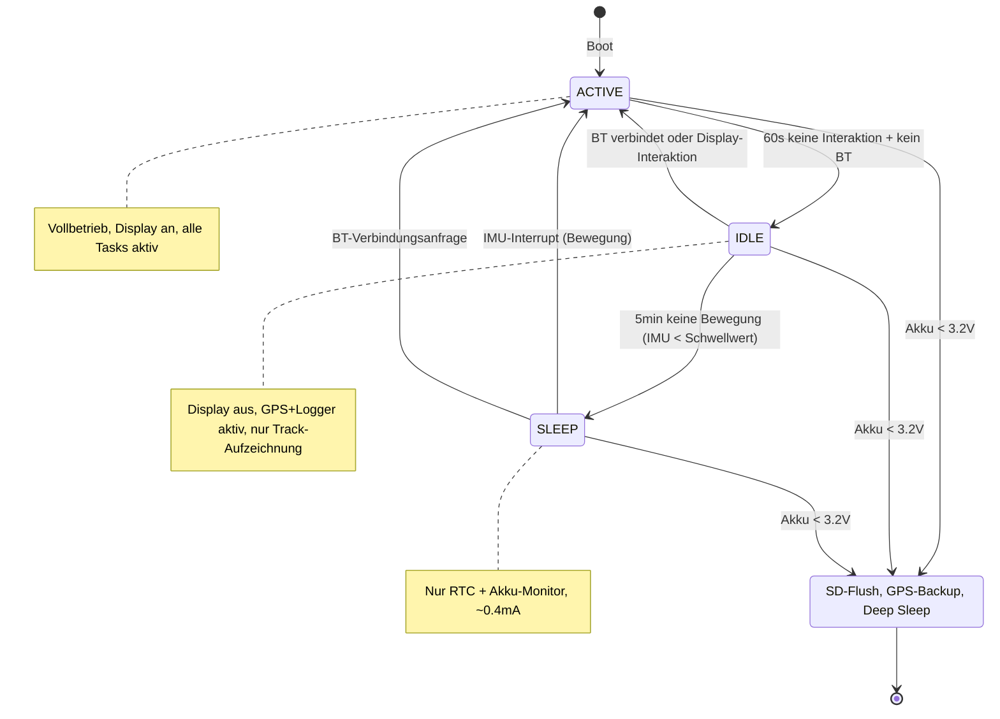
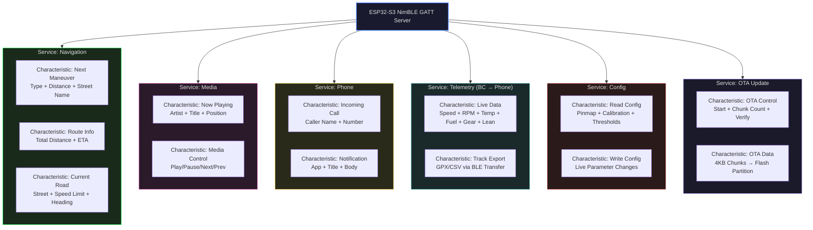

# Transalp Bordcomputer

<<<<<<< HEAD
Custom Bordcomputer für die Honda Transalp 600 (PD06, Baujahr 1986–2000) — DIY-Projekt von Tito.
=======
> Open-Source Bordcomputer für die Honda Transalp 600 (PD06) — basierend auf ESP32-S3, GPS, E-Paper/TFT, direkter Sensor-Anzapfung und BLE-Smartphone-Integration.
>>>>>>> research/pd06-hardware

[](LICENSE)
[](https://www.espressif.com/en/products/socs/esp32-s3)
[](https://docs.espressif.com/projects/esp-idf/)
[](docs/research/)
[-darkgreen.svg)](#)

<<<<<<< HEAD
Eigenbau eines kompakten Bordcomputers für Motorrad-Touren (Honda Transalp 600 PD06).
Die PD06 ist eine rein mechanische Maschine (kein CAN-Bus, kein OBD-II, keine ECU im modernen Sinn).
Bordcomputer basiert auf ESP32-S3 als Core-Modul, erweiterbar um Sensoren, GPS und Display.
Fahrzeugdaten werden über direkte Sensor-Anzapfung und separate Sensoren erfasst.
=======
---
>>>>>>> research/pd06-hardware

## Übersicht

<<<<<<< HEAD
- **GPS-Tracking**: Positionsdaten, Geschwindigkeit, Strecke
- **Display**: E-Paper oder TFT für sonnenlesbare Anzeige
- **Sensoren**: Temperatur, Luftdruck, Neigung, Beschleunigung
- **Daten-Logging**: SD-Karte für Touren-Aufzeichnung
- **Bluetooth**: Smartphone-Anbindung für Navigation/Telefonie
- **Power-Management**: Akku-Überwachung, automatische Schlafmodi
- **Fahrzeugdaten (PD06-spezifisch)**: Direkte Sensor-Anzapfung — Tachosignal, Drehzahl (Zündung), Temperatur, Ganganzeige, Kraftstoffstand
- **Zusätzliche Sensoren**: Öldruck, Umwelttemperatur, Neigung (Wheelie-Detection)
- **Steuerung**: Relais-basiert — Zusatzlicht, Heizgriffe, USB-Ladung
- **Wetter**: Live-Wetterdaten via BT-Internet vom Smartphone
=======
Dieses Projekt dokumentiert den Bau eines vollständigen Bordcomputers für die Honda Transalp 600 (PD06, Baujahr 1986–2000). Die PD06 ist eine rein mechanische Maschine ohne CAN-Bus, OBD-II oder elektronische Motorsteuerung. Alle Fahrzeugdaten werden über eigenständige Sensoren und direkte Signal-Anzapfung erfasst.
>>>>>>> research/pd06-hardware

### Kern-Features

<<<<<<< HEAD
| Komponente | Modul | Bemerkung |
|---|---|---|
| MCU | ESP32-S3 DevKit | WiFi+BT, genug GPIO, low power |
| GPS | u-blox NEO-M9N | 10Hz, hochpräzise |
| Display | Waveshare 2.9" E-Paper | sonnenlesbar, low power |
| IMU | MPU6050 | Neigung/Beschleunigung |
| Temp/Druck | BMP280 | Umgebung, Höhenmeter |
| SD | MicroSD-Modul (SPI) | Daten-Logging |
| Power | LiPo + TP4056 + Boost | 3.3V/5V Versorgung |
| Tachosignal | Optokoppler/Induktiv | Tacho-Kabel anzapfen |
| Drehzahl | Induktiver Sensor am Zündkabel | oder Hall-Sensor |
| Ganganzeige | Mikroschalter/Gabellichtschranke | Schaltwalze |
| Kraftstoffstand | Widerstandssensor im Tank | Spannungsteiler |
| Temp Motor | KTY81/PT1000 im Kühlschlauch | oder Thermistor |
| Öldruck | Drucksensor 0-10bar | 0.5-4.5V Output |
| Steuerung | Relais-Modul 4fach | Licht, Heizgriffe, etc. |
=======
- **Fahrzeugdaten**: Drehzahl (CDI-Pickup), Geschwindigkeit (GPS/Hall), Kühlmitteltemperatur, Kraftstoffstand, Öldruck, Ganganzeige, Bordspannung
- **Multi-Display**: E-Paper für Instrumente (sonnenlesbar, low power) + TFT für Navigation (dynamisch, farbig)
- **GPS-Tracking**: 10Hz GPS mit Touren-Aufzeichnung, GPX-Export, Höhenmeter, Statistiken
- **Smartphone-Integration**: BLE-Verbindung zur Companion-App — Turn-by-Turn Navigation, Wetter, Anrufbenachrichtigungen, Musik-Steuerung
- **Sensoren**: IMU (Neigung/Beschleunigung/Crash-Detection), Barometer (Höhe), Umgebungstemperatur
- **Steuerung**: Relais-basiert — Zusatzlicht, Heizgriffe, USB-Ladung
- **Safety**: Crash-Erkennung mit automatischem Notfall-SOS, Diebstahl-Warnung
- **Power-Management**: LiPo-Backup, Deep-Sleep, Wake-on-Motion, automatische Zustandsübergänge
- **OTA-Update**: Firmware-Update über Bluetooth mit Dual-Partition-Rollback
>>>>>>> research/pd06-hardware

---

## Systemarchitektur

```mermaid
graph TB
    subgraph Vehicle["Honda Transalp 600 (PD06)"]
        CDI[CDI-Zündung<br/>Pickup-Signal]
        TACHO[Tachowelle<br/>mechanisch]
        TEMP[Kühlmittel<br/>Temperatursensor]
        FUEL[Tankgeber<br/>5-90Ω]
        OIL[Öldruckschalter]
        LIGHT[Licht/Blinker<br/>12V]
    end

    subgraph Sensors["Sensor-Frontend"]
        OPT[Optokoppler<br/>Galvanische Trennung]
        IND[Induktivsensor<br/>GT101 am Zündkabel]
        HALL[Hall-Sensor<br/>am Vorderrad]
        NTC[NTC 10kΩ<br/>im Kühlschlauch]
        DIV[Spannungsteiler<br/>für Tankgeber]
        ADC_INTER[ADC-Interface<br/>esp_adc_cal]
    end

    subgraph MCU["ESP32-S3 (Core Module)"]
        CPU[Dual-Core 240MHz<br/>16MB Flash, 8MB PSRAM]
        RTOS[FreeRTOS<br/>Task-Scheduler]
        SPI_BUS[SPI Bus<br/>Display + SD]
        I2C_BUS[I2C Bus<br/>IMU + BMP280]
        UART_BUS[UART<br/>GPS NEO-M9N]
        BLE_STACK[NimBLE<br/>GATT Server]
    end

    subgraph Peripherals["Peripherie"]
        GPS[u-blox NEO-M9N<br/>10Hz, 72-Kanal]
        EPAPER[E-Paper 2.9"<br/>296×128, Partial-Refresh]
        TFT[TFT 2.4-3.5"<br/>ILI9341/ILI9488]
        IMU[MPU6050<br/>Gyro + Accel]
        BMP[BMP280<br/>Temp + Baro]
        SD[MicroSD<br/>Class 10, FAT32]
        RELAY[4-Kanal Relais<br/>Zusatzlicht/Heizgriffe]
    end

    subgraph Power["Power-Management"]
        BATT[LiPo 18650<br/>3400mAh]
        CHARGE[TP4056<br/>USB-C Laden]
        BOOST[MT3608<br/>3.7V → 5V]
        LDO[HT7333<br/>5V → 3.3V]
        MONITOR[ADC Akku-<br/>Überwachung]
    end

    subgraph Smartphone["Smartphone (Companion App)"]
        APP[React Native / Flutter<br/>Companion App]
        MAPS[Native Maps API<br/>MapKit / Google Maps]
        NAV[Turn-by-Turn<br/>Navigation Engine]
        NOTIF[Notification<br/>Relay]
        MEDIA[Now-Playing<br/>Media Control]
    end

    CDI --> OPT
    CDI --> IND
    TACHO --> HALL
    TEMP --> NTC
    FUEL --> DIV
    OIL --> OPT
    LIGHT --> OPT

    OPT --> CPU
    IND --> CPU
    HALL --> CPU
    NTC --> ADC_INTER
    DIV --> ADC_INTER
    ADC_INTER --> CPU

    GPS <-->|UART 38400| UART_BUS
    EPAPER -->|SPI| SPI_BUS
    TFT -->|SPI| SPI_BUS
    SD -->|SPI| SPI_BUS
    IMU -->|I2C 400kHz| I2C_BUS
    BMP -->|I2C 400kHz| I2C_BUS
    RELAY -->|GPIO| CPU

    BATT --> CHARGE
    BATT --> BOOST
    BOOST --> LDO
    LDO --> MCU
    LDO --> Peripherals
    BATT --> MONITOR
    MONITOR -->|ADC| CPU

    APP <-->|BLE GATT| BLE_STACK
    MAPS --> NAV
    NAV -->|Maneuver Data| BLE_STACK
    NOTIF -->|Caller/SMS| BLE_STACK
    MEDIA -->|Track Info| BLE_STACK

    RTOS --> CPU
    BLE_STACK --> CPU
    SPI_BUS --> CPU
    I2C_BUS --> CPU
    UART_BUS --> CPU

    style MCU fill:#1a1a2e,color:#e0e0e0,stroke:#578bfc,stroke-width:2px
    style Vehicle fill:#1a2a1a,color:#e0e0e0,stroke:#00fe40,stroke-width:2px
    style Power fill:#2a1a1a,color:#e0e0e0,stroke:#ff6b6b,stroke-width:2px
    style Smartphone fill:#1a1a2a,color:#e0e0e0,stroke:#578bfc,stroke-width:2px
    style Sensors fill:#2a2a1a,color:#e0e0e0,stroke:#ffd93d,stroke-width:1px
    style Peripherals fill:#1a2a2a,color:#e0e0e0,stroke:#4ecdc4,stroke-width:1px
```

---

## Software-Architektur (FreeRTOS Task-Modell)

```mermaid
graph LR
    subgraph Core1["Core 1 (Real-Time)"]
        GPS_TASK[gps_task<br/>10 Hz | Prio 5]
        SENSOR_TASK[sensor_task<br/>50 Hz | Prio 4]
        VEHICLE_TASK[vehicle_task<br/>10 Hz | Prio 4]
    end

    subgraph Core0["Core 0 (UI + Comms)"]
        DISPLAY_TASK[display_task<br/>1 Hz | Prio 2]
        LOGGER_TASK[logger_task<br/>5 Hz | Prio 3]
        BLE_TASK[ble_task<br/>Event | Prio 3]
        POWER_TASK[power_task<br/>1 Hz | Prio 6]
    end

    GPS_TASK -->|Queue| DISPLAY_TASK
    GPS_TASK -->|Queue| LOGGER_TASK
    SENSOR_TASK -->|Queue| DISPLAY_TASK
    SENSOR_TASK -->|Queue| LOGGER_TASK
    VEHICLE_TASK -->|Queue| DISPLAY_TASK
    VEHICLE_TASK -->|Queue| LOGGER_TASK
    BLE_TASK <-->|GATT| DISPLAY_TASK
    POWER_TASK -->|EventGroup| GPS_TASK
    POWER_TASK -->|EventGroup| SENSOR_TASK
    POWER_TASK -->|EventGroup| DISPLAY_TASK

    style Core1 fill:#1a1a2e,color:#e0e0e0,stroke:#578bfc
    style Core0 fill:#1a2a1a,color:#e0e0e0,stroke:#00fe40
```

### Task-Übersicht

| Task | Core | Priorität | Stack | Rate | Beschreibung |
|---|---|---|---|---|---|
| `gps_task` | 1 | 5 | 4 KB | 10 Hz | NMEA-Parsing über UART, Position/Geschwindigkeit |
| `sensor_task` | 1 | 4 | 4 KB | 50 Hz | IMU + Barometer über I2C, gleitender Mittelwert |
| `vehicle_task` | 1 | 4 | 4 KB | 10 Hz | Drehzahl, Tacho, Temp, Kraftstoff, Öldruck (ADC/Pulse) |
| `display_task` | 0 | 2 | 6 KB | 1 Hz | UI-Rendering auf E-Paper + TFT |
| `logger_task` | 0 | 3 | 4 KB | 5 Hz | SD-Karten-Logging (Ringbuffer → Batch-Write) |
| `ble_task` | 0 | 3 | 4 KB | Event | BLE-GATT Server für Smartphone-Kommunikation |
| `power_task` | 0 | 6 | 2 KB | 1 Hz | Akku-Überwachung, Sleep-Entscheidung, Zustandsmaschine |

---

## Power-Management Zustandsmaschine



---

## BLE-GATT Service-Architektur



---

## Repository-Struktur

```
transalp-bordcomputer/
├── README.md
├── LICENSE                          PolyForm Noncommercial License
├── docs/
│   ├── ARCHITECTURE.md              Software-Architektur, Task-Modell
│   ├── HARDWARE.md                  Schaltplan, Pin-Mapping, Stromversorgung
│   ├── PINMAP.md                    GPIO-Belegung ESP32-S3
│   └── research/                    Exhaustive Recherche (34.000+ Wörter)
│       ├── README.md                Index & Zusammenfassung
│       ├── 01-sensoren-fahrzeugdaten.md
│       ├── 02-hardware-deep-dive.md
│       ├── 03-software-stack.md
│       ├── 04-pd06-technische-daten.md
│       ├── 05-gehaeuse-einbau-emv.md
│       ├── 06-feature-roadmap.md
│       └── 07-display-navigation-smartphone.md
├── firmware/
<<<<<<< HEAD
│   ├── main/                # ESP-IDF main app
├── components/          # Wiederverwendbare Komponenten
│   ├── gps/             # GPS-Treiber + NMEA-Parsing
│   ├── display/         # E-Paper Treiber + UI
│   ├── sensors/         # IMU, BMP280
│   ├── vehicle/         # PD06-Sensoren: Drehzahl, Tacho, Gang, Temp, Kraftstoff
│   ├── logger/          # SD-Karten Logging
│   ├── ble/             # Bluetooth LE Kommunikation
│   ├── power/           # Power Management
│   └── control/         # Relais-Steuerung (Licht, Heizgriffe, etc.)
=======
>>>>>>> research/pd06-hardware
│   ├── CMakeLists.txt
│   ├── partitions.csv               OTA-fähige Partition-Tabelle
│   ├── sdkconfig.defaults           ESP-IDF Build-Konfiguration
│   ├── main/
│   │   ├── main.c                   Boot-Sequenz, startet alle Tasks
│   │   └── CMakeLists.txt
│   └── components/
│       ├── gps/                     GPS-Treiber (NEO-M9N, NMEA/UBX)
│       ├── display/                 E-Paper + TFT Treiber, UI
│       ├── sensors/                 IMU (MPU6050), Baro (BMP280)
│       ├── vehicle/                 PD06-Sensoren: RPM, Tacho, Temp, Fuel
│       ├── logger/                  SD-Karten Logging (CSV/GPX)
│       ├── ble/                     NimBLE GATT Server
│       ├── power/                   Power-Management, Zustandsmaschine
│       └── control/                Relais-Steuerung
├── hardware/
│   ├── kicad/                       KiCad-Schaltpläne + PCB
│   └── case/                        Gehäuse-Design (STL/FreeCAD)
└── tools/
    └── export_track.py              CSV → GPX Export-Tool
```

---

<<<<<<< HEAD
🚧 Planungsphase — Recherche abgeschlossen (33.500 Wörter in `docs/research/`), Hardware-Teile werden spezifiziert.
=======
## Hardware-Komponenten
>>>>>>> research/pd06-hardware

| Komponente | Modul | Bemerkung |
|---|---|---|
| MCU | ESP32-S3-WROOM-1 | Dual-Core 240MHz, 16MB Flash, 8MB PSRAM, BLE 5 |
| GPS | u-blox NEO-M9N | 10Hz, 72-Kanal, UBX-konfigurierbar |
| Display 1 | Waveshare 2.9" E-Paper | 296×128, Partial-Refresh, sonnenlesbar |
| Display 2 | ILI9341 / ILI9488 TFT | 2.4"-3.5", für Navigation |
| IMU | MPU6050 | Gyro + Accel, I2C, Neigung/Crash-Detection |
| Barometer | BMP280 | Temperatur + Luftdruck, Höhenmeter |
| Speicher | MicroSD (SPI) | Class 10, FAT32, Daten-Logging |
| Drehzahl | Induktivsensor GT101 | Am Zündkabel, Pulse-Counter (pcnt) |
| Kühlmitteltemp | NTC 10kΩ | Im Kühlschlauch, ADC + Spannungsteiler |
| Kraftstoffstand | Tankgeber 5-90Ω | Spannungsteiler → ADC, kalibriert |
| Öldruck | VDO 0-10bar | Analog 0.5-4.5V, 1/8-27 NPT |
| Power | LiPo 18650 + TP4056 + MT3608 + HT7333 | 3400mAh, USB-C Ladung, Buck/Boost |
| Steuerung | 4-Kanal Relais-Modul | Zusatzlicht, Heizgriffe, USB, Zubehör |

---

## Spannungsversorgung

```
LiPo 3.7V ──┬── TP4056 (Laden via USB-C)
            │
            ├── MT3608 Boost → 5V ──┬── E-Paper / TFT
            │                       └── HT7333 LDO → 3.3V ──┬── ESP32-S3
            │                                                 ├── MPU6050
            │                                                 ├── BMP280
            │                                                 ├── NEO-M9N
            │                                                 └── SD-Karte
            │
            └── Spannungsteiler → ADC (Akku-Überwachung)
```

### Stromabschätzung

| Zustand | Stromverbrauch | Akkulaufzeit (3400mAh) |
|---|---|---|
| Aktiv (alle Module) | ~140 mA | ~24 Stunden |
| Idle (Display aus, GPS+Logger) | ~35 mA | ~4 Tage |
| Sleep (RTC + Akku-Monitor) | ~0.4 mA | ~1 Jahr |

---

## Schnellstart

### Voraussetzungen

- ESP-IDF v5.x mit Toolchain
- Python 3.9+
- Git

### Build & Flash

```bash
git clone https://github.com/TitoPrausee/transalp-bordcomputer.git
cd transalp-bordcomputer

# ESP-IDF Umgebung aktivieren
. $IDF_PATH/export.sh

# Build
cd firmware
idf.py set-target esp32s3
idf.py build

# Flash + Monitor
idf.py -p /dev/cu.usbmodem* flash monitor
```

### Track-Export

```bash
python3 tools/export_track.py /sdcard/logs/SESSION_20261013_140000.csv -o track.gpx
```

---

## Recherche

Die komplette Recherche mit über 34.000 Wörtern befindet sich in [`docs/research/`](docs/research/README.md). Sie deckt ab:

- Sensor-Anzapfung an der PD06 (Drehzahl, Tacho, Temp, Kraftstoff, Öldruck, Gang)
- Hardware-Deep-Dive (ESP32-S3, GPS, Display, Power-Management)
- Software-Stack (ESP-IDF, FreeRTOS, Treiber, BLE, OTA)
- Technische Daten der PD06 (Motor, Getriebe, Elektrik, Service-Manual)
- Gehäuse, Einbau, Wasserdichtigkeit, EMV
- Feature-Roadmap (Core, Smart, Safety, Tour, Diagnose)
- Multi-Display, Smartphone-Integration, Turn-by-Turn Navigation

---

## Lizenz

Dieses Projekt steht unter der **PolyForm Noncommercial License 1.0.0**.

- ✅ **Nutzen**: Frei für private und Bildungszwecke
- ✅ **Modifizieren**: Source Code anpassen und erweitern
- ✅ **Teilen**: Weiterverbreitung unter gleicher Lizenz
- ❌ **Verkaufen**: Keine kommerzielle Nutzung oder Vermarktung
- ❌ **Rebranding**: Keine Umbenennung und Vermarktung unter eigenem Namen

Siehe [LICENSE](LICENSE) für den vollständigen Lizenztext.

---

## Mitwirkende

**Tito Tarek Prause** — Projektersteller & Maintainer

Beiträge via Pull Request willkommen. Durch das Einreichen eines Beitrags stimmen Sie zu, dass Ihre Änderungen unter derselben PolyForm Noncommercial Lizenz stehen.

---

## Danksagung

- [Espressif](https://www.espressif.com/) für ESP-IDF und ESP32-S3
- [u-blox](https://www.u-blox.com/) für NEO-M9N GPS-Module
- Honda Transalp 600 Community (ADV Rider, Honda-Forum.de)
- Alle Open-Source-Projekte, deren Libraries und Dokumentation in der Recherche referenziert wurden
