# Dokumentations-Index / Projekt-Wiki

> Zentraler Einstiegspunkt fuer die gesamte Dokumentation des Transalp Bordcomputer-Projekts.
> Stand: Oktober 2026 — Phasen 0-6 abgeschlossen (RELEASE-READY), 52 Dokumente, 264.832 Woerter gesamt.
> Plattform: ESP32-S3-WROOM-1, ESP-IDF v5.4, FreeRTOS SMP
> Fahrzeug: Honda XL600V Transalp 600 (PD06), Baujahr 1986-1999

---

## Inhaltsverzeichnis

1. [Schnelleinstieg](#1-schnelleinstieg)
2. [Vollstaendiger Dokumentations-Baum](#2-vollstaendiger-dokumentations-baum)
3. [Dokument-Kategorien](#3-dokument-kategorien)
4. [Dokumenten-Abhaengigkeits-Graph](#4-dokumenten-abhaengigkeits-graph)
5. [Empfohlene Lese-Reihenfolge](#5-empfohlene-lese-reihenfolge)
6. [Dokument-Metriken](#6-dokument-metriken)

---

## 1. Schnelleinstieg

Nicht sicher, wo Sie anfangen sollen? Waehlen Sie Ihr Ziel:

### Ich will das Projekt verstehen

| Dokument | Beschreibung | Link |
|---|---|---|
| README | Projekt-Uebersicht mit Inhaltsverzeichnis, Feature-Liste, Metriken und Systemarchitektur-Diagramm. Der Ausgangspunkt fuer jeden Leser. | [README.md](../README.md) |
| ARCHITECTURE | Integrierte System-Architektur mit 8 Subsystemen, Datenfluss-Pipeline, FreeRTOS Task-Modell, Hardware-Schnittstellen und Komponenten-Details. | [docs/ARCHITECTURE.md](ARCHITECTURE.md) |
| ROADMAP | Vollstaendige Projekt-Roadmap mit allen Phasen (0-6), PM-Protokoll (32 Runden), Metriken und Worker-Team. Zeigt den gesamten Entstehungsprozess. | [docs/ROADMAP.md](ROADMAP.md) |

### Ich will entwickeln

| Dokument | Beschreibung | Link |
|---|---|---|
| DEVELOPER-QUICKSTART | Von 0 zu laufendem Build in unter 30 Minuten. ESP-IDF-Setup, Repo-Klonen, Firmware-Build, Companion-App-Build, Mockups, Tests, Debugging. | [docs/DEVELOPER-QUICKSTART.md](DEVELOPER-QUICKSTART.md) |
| FIRMWARE-GUIDE | Firmware-Engineering-Guide: Build-System, 10 Komponenten, FreeRTOS Tasks, Debugging, OTA-Update-Architektur und Code-Struktur. | [docs/FIRMWARE-GUIDE.md](FIRMWARE-GUIDE.md) |
| API-REFERENCE | BLE GATT Interface-Referenz: 8 Services, 33 Characteristics, UUIDs, Datenformate, OTA-Protokoll. Die vollstaendige BLE-Schnittstellendefinition. | [docs/API-REFERENCE.md](API-REFERENCE.md) |
| WIDGET-CATALOG | E-Paper Widget-Katalog: 18 Widgets, 6 Screen-Layouts, Rendering-Pipeline und Entwicklungs-Guide fuer eigene Widgets. | [docs/WIDGET-CATALOG.md](WIDGET-CATALOG.md) |

### Ich will bauen (Hardware)

| Dokument | Beschreibung | Link |
|---|---|---|
| BOM | Bill of Materials & Sourcing-Konzept: Alle Komponenten mit Preisen, Quellen, Alternativen und 3 Ausbau-Stufen. | [docs/BOM.md](BOM.md) |
| PCB-LAYOUT | PCB-Layout-Konzept: Layer-Stackup (4-Layer), Routing-Regeln, EMV-Optimierung, Differential-Pairs und Design-Constraints. | [docs/PCB-LAYOUT.md](PCB-LAYOUT.md) |
| HARDWARE | Hardware-Schaltplan: Pin-Layout, Verdrahtungsplan, Stromversorgung, Sensor-Anzapfung und Signal-Konditionierung. | [docs/HARDWARE.md](HARDWARE.md) |
| PINMAP | GPIO-Belegung des ESP32-S3: Alle Pins mit Funktion, Signal, Bus-Zugehoerigkeit und Konflikten. | [docs/PINMAP.md](PINMAP.md) |
| SENSOR-MOUNTING | Sensor-Anschlusspunkte an der PD06: CDI-Pinout, Öldruckschalter, Kühlmitteltemp, Kraftstoff, Tacho, Kabelverlegung. | [docs/SENSOR-MOUNTING.md](SENSOR-MOUNTING.md) |
| SHOPPING-LIST | Kompakte Einkaufsliste Standard-Konfiguration: 61 Bauteile mit Preisen, Quellen und Bestellreihenfolge. | [docs/SHOPPING-LIST.md](SHOPPING-LIST.md) |
| INSTALLATION-GUIDE | Montage-Anleitung fuer die PD06: PCB-Einbau, Verkabelung, Display-Montage, Inbetriebnahme und PD06-spezifische Hinweise. | [docs/INSTALLATION-GUIDE.md](INSTALLATION-GUIDE.md) |
| CASE-DESIGN | Gehaeuse-Design: 3D-Druck-Konzept, Montage-Strategie, Wasserfestigkeit (IP65), Vibration-daempfung und Temperatur-Management. | [docs/CASE-DESIGN.md](CASE-DESIGN.md) |

### Ich will beitragen

| Dokument | Beschreibung | Link |
|---|---|---|
| CONTRIBUTING | Open-Source Beitragenden-Leitfaden: Fork-Workflow, CI-Anforderungen, Markennamen-Richtlinie, Code-Style und Issue-Templates. | [../CONTRIBUTING.md](../CONTRIBUTING.md) |
| CI-CD-PIPELINE | CI/CD-Pipeline-Dokumentation: 4 GitHub-Workflows (Firmware-Build, Companion-App, Docs-Check, Pages), Unit-Tests und Markennamen-Blockliste. | [docs/CI-CD-PIPELINE.md](CI-CD-PIPELINE.md) |
| TEST-STRATEGY | Test-Strategie & Benchmark-Konzept: Unit-Tests, Hardware-in-the-Loop, Performance-Benchmarks und Test-Pyramide. | [docs/TEST-STRATEGY.md](TEST-STRATEGY.md) |

### Ich habe ein Problem

| Dokument | Beschreibung | Link |
|---|---|---|
| TROUBLESHOOTING | Troubleshooting-Guide & FAQ: Hardware-, Software-, BLE-, GPS-, SD-Karten- und Power-Probleme. Mit Serial-Console-Guide und Loesungen fuer 50+ bekannte Probleme. | [docs/TROUBLESHOOTING.md](TROUBLESHOOTING.md) |

### Ich will das System evaluieren

| Dokument | Beschreibung | Link |
|---|---|---|
| FIELDTEST-PROTOCOL | Feldtest-Protokoll: 8 Test-Phasen, 25 Metriken mit Pass/Fail-Schwellen, Test-Routen und Bewertungskriterien fuer die Praxis-Erprobung. | [docs/FIELDTEST-PROTOCOL.md](FIELDTEST-PROTOCOL.md) |
| BENCHMARK-SPEC | Benchmark-Spezifikation: Zielwerte fuer CPU-Auslastung, Speicher, Rendering-FPS, BLE-Latenz und Boot-Zeit. | [docs/BENCHMARK-SPEC.md](BENCHMARK-SPEC.md) |
| PERFORMANCE-OPTIMIZATION | Performance-Optimierung & Profiling: CPU, Speicher, Rendering, Sensor-Raten, BLE und Power-Optimierung mit Profiling-Strategie. | [docs/PERFORMANCE-OPTIMIZATION.md](PERFORMANCE-OPTIMIZATION.md) |
| SECURITY-ANALYSIS | Sicherheitsanalyse & Threat Model (STRIDE): 19 Threats in 6 Kategorien mit MoSCoW-Mitigation-Plan und Code-Snippets. | [docs/SECURITY-ANALYSIS.md](SECURITY-ANALYSIS.md) |

---

## 2. Vollstaendiger Dokumentations-Baum

Alle 52 Dokumente gruppiert nach Projektphase und Thema. Woerterzahlen aus `wc -w` (Oktober 2026).

### Phase 0: Recherche (17 Dokumente, ~98.328 Woerter)

Recherche-Phase: Fundament fuer alle Entscheidungen. Fahrzeugdaten, Hardware-Optionen, Software-Stack, Gehaeuse-Design und Feature-Roadmap wurden systematisch recherchiert.

| # | Datei | Thema | Woerter | Status |
|---|---|---|---|---|
| 01 | [01-sensoren-fahrzeugdaten.md](research/01-sensoren-fahrzeugdaten.md) | Drehzahl, Tacho, Kuehlmitteltemperatur, Kraftstoffstand, Oeldruck, Ganganzeige, Bordspannung — direkte Sensor-Anzapfung an der PD06 mit Schaltungen, Signalcharakteristik und ESP32-Code | 5.750 | Fertig |
| 02 | [02-hardware-deep-dive.md](research/02-hardware-deep-dive.md) | ESP32-S3, GPS-Module, E-Paper/TFT-Displays, IMU, Barometer, Power-Management (Buck/Boost/LDO), SD-Logging, Bluetooth — Modulauswahl, Preise und Pin-Belegungen | 6.619 | Fertig |
| 03 | [03-software-stack.md](research/03-software-stack.md) | ESP-IDF vs. Arduino-Framework, FreeRTOS Task-Design, GPS-Treiber, Display-Treiber, Sensor-Treiber, Daten-Logging, BLE-Stack, OTA-Update, NVS-Config | 7.374 | Fertig |
| 04 | [04-pd06-technische-daten.md](research/04-pd06-technische-daten.md) | Motor-/Getriebedaten (Leistung, Drehmoment, Uebersetzungen), Elektrik (Lichtmaschine, Regler, Batterie), Fahrwerk, Tank/Kraftstoff, Service-Manual-Quellen | 5.000 | Fertig |
| 05 | [05-gehaeuse-einbau-emv.md](research/05-gehaeuse-einbau-emv.md) | 3D-Druck-Gehaeuse, Wasserdichtigkeit (IP-Ratings), Vibrationen/Stoesse, Temperaturbereich, EMV-Schutz (Zuendfunken, Abschirmung), Lastabwurf-Schutz | 5.602 | Fertig |
| 06 | [06-feature-roadmap.md](research/06-feature-roadmap.md) | Vollstaendige Feature-Roadmap: Core-Features, Smart-Features (BLE+Smartphone), Safety (Crash-Detection, SOS), Tour-Features, Diagnose, App-Konzept | 6.317 | Fertig |
| 07 | [07-display-navigation-smartphone.md](research/07-display-navigation-smartphone.md) | Multi-Display-Architektur, Smartphone-Integration per BLE, Turn-by-Turn Navigation UI, Companion-App-Konzept, GATT-Service-Design | 2.434 | Fertig |
| 08 | [08-feature-realization-matrix.md](research/08-feature-realization-matrix.md) | Feature-Realisierungs-Matrix: Datenlage -> Machbarkeit fuer alle Features. Systematische Bewertung von Sensor-Verfuegbarkeit zu Feature-Umsetzung. | 6.865 | Fertig |
| 09 | [09-master-plan.md](research/09-master-plan.md) | Master-Plan: Umsetzungs-Roadmap mit Kosten-Nutzen-Analyse, BOM, 3 Ausbau-Stufen, 5-Phasen-Plan (10 Wochen), DTC-System, Support-Schnittstellen, QS-Strategie, Risikomatrix | 9.838 | Fertig |
| 10 | [10-ui-ux-design.md](research/10-ui-ux-design.md) | Premium UI/UX Design-Konzept: Animationen, Layouts, Screens, Color-Palette, Visual Language, Widget-Design-Prinzipien | 8.278 | Fertig |
| 11 | [11-firmware-architecture.md](research/11-firmware-architecture.md) | Firmware-Architektur: Rendering-Engine, Animations-Framework, BLE-Stack, Diagnose, OTA, Konfiguration, Task-Modell, Daten-Pipeline | 9.411 | Fertig |
| 12 | [12-diagnose-support.md](research/12-diagnose-support.md) | Diagnose, Support & Wartbarkeit: DTC-System, Self-Test, Remote-Diagnose, Reparaturfreundliche Architektur | 7.593 | Fertig |
| 13 | [13-connectivity-app.md](research/13-connectivity-app.md) | Connectivity & Companion-App: GATT-Services, App-Architektur, BLE-Protokoll-Design, Datenformate, Communication-Pattern | 7.948 | Fertig |
| 14 | [14-obd-ii-integration.md](research/14-obd-ii-integration.md) | OBD-II Integration: ELM327-Adapter, PID-Emulation, Diagnose-Support. Emulator (Sensordaten als OBD-PIDs) und Reader (externer Adapter). SAE J1979 PIDs, BLE-GATT-Characteristics, Companion-App OBD-Screen | 3.050 | Fertig |
| 15 | [15-cloud-sync.md](research/15-cloud-sync.md) | Cloud-Sync: Touren-Backup und Statistiken. Gist API als Free-Tier, Self-hosted Backend (Node.js + SQLite). Offline-First, DSGVO, PolyForm Noncommercial. JSON-Tour-Format, SyncManager | 2.866 | Fertig |
| 16 | [16-tacho-kalibrierung.md](research/16-tacho-kalibrierung.md) | Tachokalibrierung: VSS-basierte Geschwindigkeitsmessung (Hall-Sensor), GPS-Auto-Kalibrierung, Radumfang/Uebersetzung konfigurierbar, Kalibrierungs-Wizard in Companion-App | 2.946 | Fertig |
| -- | [research/README.md](research/README.md) | Research-Index mit Zusammenfassung der Erkenntnisse aus allen 16 Research-Dokumenten. Schnellreferenz fuer Fahrzeug, Hardware, Software und Smartphone-Integration. | 437 | Fertig |

### Phase 1.5: Qualitaetsbereinigung

| Dokument | Beschreibung | Woerter | Status |
|---|---|---|---|
| (Phase 1.5) | Markennamen-Entfernung in 9+3 Dokumenten (46+ Verweise entfernt). Kein separates Dokument — die Bereinigung erfolgte inline in den Research- und Design-Dokumenten. Verifiziert via grep: 0 Markennamen im Prosa. | -- | Fertig |

### Phase 2: Design & Prototyp (5 Dokumente)

Design-Phase: Uebergang von Recherche zu konkreten Konzepten. PCB-Layout, Test-Strategie, Gehaeuse, Hardware-Schaltplan und Pinmap.

| # | Datei | Thema | Woerter | Status |
|---|---|---|---|---|
| 14 | [PCB-LAYOUT.md](PCB-LAYOUT.md) | PCB-Layout-Konzept: 4-Layer-Stackup (Signal/Ground/Power/Signal), Routing-Regeln, EMV-Optimierung, Differential-Pairs, Impedanz-Kontrolle, Design-Constraints | 5.993 | Fertig |
| 15 | [TEST-STRATEGY.md](TEST-STRATEGY.md) | Test-Strategie & Benchmark-Konzept: Unit-Tests, Hardware-in-the-Loop, Performance-Benchmarks, Test-Pyramide, Test-Coverage-Ziele, Mock-Strategie | 12.965 | Fertig |
| 16 | [CASE-DESIGN.md](CASE-DESIGN.md) | Gehaeuse-Design: 3D-Druck-Konzept (PETG/ABS), Montage-Strategie, Wasserfestigkeit (IP65), Vibration-daempfung, Temperatur-Management, Kabelfuehrung | 5.877 | Fertig |
| 17 | [HARDWARE.md](HARDWARE.md) | Hardware-Schaltplan: Pin-Layout, Verdrahtungsplan, Stromversorgung (Buck/Boost/LDO), Sensor-Anzapfung, Signal-Konditionierung, Schutzschaltungen | 5.487 | Fertig |
| 18 | [PINMAP.md](PINMAP.md) | GPIO-Belegung des ESP32-S3-WROOM-1: Alle Pins mit Funktion, Signal, Bus-Zugehoerigkeit, Konflikten und alternativen Pin-Optionen | 1.609 | Fertig |

### Phase 2.5: Erweiterung (3 Dokumente)

| # | Datei | Thema | Woerter | Status |
|---|---|---|---|---|
| 19 | [BOM.md](BOM.md) | Bill of Materials & Sourcing-Konzept: Alle Komponenten mit Preisen, Quellen, Alternativen, 3 Ausbau-Stufen (Basis/Standard/Premium) und Bezugsquellen | 7.528 | Fertig |
| 20 | [USER-MANUAL.md](USER-MANUAL.md) | Benutzerhandbuch: Bedienung, Displays (TFT + E-Paper), Companion-App, Touren-Verwaltung, Wartung, Konfiguration und Fehlersuche aus Anwender-Sicht | 8.942 | Fertig |
| 21 | [FIRMWARE-GUIDE.md](FIRMWARE-GUIDE.md) | Firmware-Engineering-Guide: Build-System (ESP-IDF/CMake), 10 Komponenten, FreeRTOS Tasks, Debugging, OTA-Update-Architektur, Code-Struktur und Konventionen | 5.363 | Fertig |

### Phase 3: Implementierung (1 Dokument + Code)

| # | Datei | Thema | Woerter | Status |
|---|---|---|---|---|
| 22 | [ARCHITECTURE.md](ARCHITECTURE.md) | Integrierte System-Architektur: 8 Subsysteme (Sensoren, GPS, Display, Storage, BLE, Power, Diagnose, OTA), Datenfluesse, FreeRTOS Task-Modell (7 Tasks), Hardware-Schnittstellen, Companion-App-Architektur, Datenmodell | 8.845 | Fertig |

### Phase 4: Integration & Test (11 Dokumente)

Integration- und Test-Phase: System wird als Ganzes betrachtet. API-Dokumentation, Release-Notes, Troubleshooting, Montage, Feldtest, Performance, CI/CD, Sicherheit, TCO und Benchmark.

| # | Datei | Thema | Woerter | Status |
|---|---|---|---|---|
| 23 | [API-REFERENCE.md](API-REFERENCE.md) | BLE GATT Interface-Referenz: 8 Services (Telemetry, Navigation, Media, Phone, Weather, Config, Diagnose, OTA), 33 Characteristics mit UUIDs, Datenformaten, OTA-Protokoll (4 KB Chunks, SHA-256) | 7.297 | Fertig |
| 24 | [RELEASE-NOTES.md](RELEASE-NOTES.md) | Release-Notes v1.0: Feature-Liste mit Status (Stable/Beta/Experimental), Hardware-Anforderungen, bekannte Einschraenkungen, Changelog-Konzept und Migrations-Notes | 5.146 | Fertig |
| 25 | [TROUBLESHOOTING.md](TROUBLESHOOTING.md) | Troubleshooting-Guide & FAQ: Hardware-, Software-, BLE-, GPS-, SD-Karten- und Power-Probleme. 50+ Loesungen, Serial-Console-Guide, Debug-Tipps und FAQ | 9.199 | Fertig |
| 26 | [INSTALLATION-GUIDE.md](INSTALLATION-GUIDE.md) | Montage-Anleitung & Einbau-Konzept fuer die PD06: PCB-Einbau, Verkabelung (Schema), Display-Montage, Sensor-Platzierung, Inbetriebnahme und PD06-spezifische Hinweise | 8.755 | Fertig |
| 27 | [FIELDTEST-PROTOCOL.md](FIELDTEST-PROTOCOL.md) | Feldtest-Protokoll: 8 Test-Phasen (Vorfahrt, Stadt, Land, Autobahn, Regen, Nacht, Berg, Dauer), 25 Metriken mit Pass/Fail-Schwellen, Test-Routen und Bewertungskriterien | 8.236 | Fertig |
| 28 | [PERFORMANCE-OPTIMIZATION.md](PERFORMANCE-OPTIMIZATION.md) | Performance-Optimierung & Profiling: CPU-Auslastung, Speicher-Management, Rendering-Pipeline, Sensor-Raten, BLE-Latenz, Power-Optimierung und Profiling-Strategie | 8.639 | Fertig |
| 29 | [SECURITY-ANALYSIS.md](SECURITY-ANALYSIS.md) | Sicherheitsanalyse & Threat Model (STRIDE): 19 Threats in 6 Kategorien (Spoofing, Tampering, Repudiation, Info-Disclosure, DoS, Elevation), MoSCoW-Mitigation-Plan mit Code-Snippets | 5.909 | Fertig |
| 30 | [TCO-ANALYSIS.md](TCO-ANALYSIS.md) | Total Cost of Ownership: 3 Szenarien (Basis 80 EUR / Standard 327 EUR / Premium 417 EUR), 5-Jahres-Lifecycle, ROI 38-66%, Wartungs- und Betriebskosten | 6.110 | Fertig |
| 31 | [CI-CD-PIPELINE.md](CI-CD-PIPELINE.md) | CI/CD-Pipeline: 4 GitHub-Workflows (firmware-ci, companion-app-ci, docs-ci, pages), Unit-Tests (test_dtc, test_event_loop, test_nmea_parser), ESP-IDF-Mocks, Markennamen-Blockliste | 3.094 | Fertig |
| 32 | [HARDWARE-TEST-BENCH.md](HARDWARE-TEST-BENCH.md) | Hardware-Test-Bench: Signal-Simulatoren (RPM, Tacho, Temp), Test-Prozeduren fuer jede Komponente, HIL-Setup und Automatisierungs-Skripte | 6.159 | Fertig |
| 33 | [BENCHMARK-SPEC.md](BENCHMARK-SPEC.md) | Benchmark-Spezifikation: Zielwerte fuer CPU-Auslastung (<70%), Heap (>2 MB frei), Rendering (30 FPS TFT), BLE-Latenz (<100 ms), Boot-Zeit (<5 s) | 3.397 | Fertig |

### Phase 5: Polish & Release (4 Dokumente)

Polish-Phase: Widget-Katalog, Developer-Quickstart und Begleitdokumente fuer die Oeffentlichkeit.

| # | Datei | Thema | Woerter | Status |
|---|---|---|---|---|
| 34 | [WIDGET-CATALOG.md](WIDGET-CATALOG.md) | E-Paper Widget-Katalog: 18 Widgets (Speed, RPM-Bar, Gear, Nav-Arrow, Tank, Temp, Clock, Compass, Altitude, Trip, etc.), 6 Screen-Layouts, Rendering-Pipeline und Entwicklungs-Guide fuer eigene Widgets | 6.619 | Fertig |
| 35 | [DEVELOPER-QUICKSTART.md](DEVELOPER-QUICKSTART.md) | Developer Quick-Start Guide: Von 0 zu laufendem Build in unter 30 Minuten — ESP-IDF-Setup, Repo-Klonen, Firmware-Build, Companion-App-Build, Mockups, Tests ausfuehren, Debugging und CI/CD verstehen | 1.948 | Fertig |
| 36 | [README.md](../README.md) | Projekt-Uebersicht: Feature-Liste mit Reifegrad, Systemarchitektur (Mermaid), FreeRTOS Task-Tabelle, Projekt-Struktur, Hardware-Komponenten, Stromversorgung, CI/CD, Metriken und Roadmap. Der Haupteinstiegspunkt. | 3.032 | Fertig |
| 37 | [CONTRIBUTING.md](../CONTRIBUTING.md) | Open-Source Beitragenden-Leitfaden: Fork-Workflow, Feature-Branch-Konvention, CI-Anforderungen (firmware-ci, companion-app-ci, docs-ci), Markennamen-Richtlinie mit Blockliste, Code-Style und Issue-Templates (bug_report, feature_request) | 2.305 | Fertig |

### Phase 6: Projekt-Wiki (dieses Dokument)

| # | Datei | Thema | Woerter | Status |
|---|---|---|---|---|
| 38 | [INDEX.md](INDEX.md) | Dokumentations-Index / Projekt-Wiki: Zentraler Einstiegspunkt fuer alle Dokumente — Schnelleinstieg, vollstaendiger Dokumentations-Baum, Kategorien und Abhaengigkeits-Graph | ~3.200 | Fertig |

### Begleitende READMEs

| # | Datei | Thema | Woerter | Status |
|---|---|---|---|---|
| 39 | [companion-app/README.md](../companion-app/README.md) | Companion-App README: React-Native-App-Uebersicht, Setup (Expo/Metro), Build-Befehle und App-Struktur (BleManager, Dashboard, Navigation, Diagnose, Settings) | 647 | Fertig |

### Zusammenfassung nach Phase

| Phase | Dokumente | Woerter | Status |
|---|---|---|---|
| Phase 0: Recherche | 14 (13 + Research-README) | 89.466 | Fertig |
| Phase 1.5: Qualitaetsbereinigung | (inline) | -- | Fertig |
| Phase 2: Design & Prototyp | 5 | 31.931 | Fertig |
| Phase 2.5: Erweiterung | 3 | 21.833 | Fertig |
| Phase 3: Implementierung | 1 | 8.845 | Fertig |
| Phase 4: Integration & Test | 11 | 72.951 | Fertig |
| Phase 5: Polish & Release | 4 | 13.904 | Fertig |
| Phase 6: Projekt-Wiki | 1 | ~3.200 | Fertig |
| Root / Begleitend | 2 | 3.679 | Fertig |
| **Gesamt** | **52** | **~264.832** | **Fertig** |

---

## 3. Dokument-Kategorien

### 3.1 Research (17 Dokumente, ~98.328 Woerter)

Die Research-Dokumente bilden das Fundament des Projekts. Sie wurden in Phase 0 erstellt und enthalten systematische Recherchen zu Fahrzeug, Hardware, Software und Features.

| Dokument | Thema | Woerter |
|---|---|---|
| [01-sensoren-fahrzeugdaten.md](research/01-sensoren-fahrzeugdaten.md) | Fahrzeugdaten-Sensoren: Drehzahl, Tacho, Kuehlmitteltemp, Kraftstoffstand, Oeldruck, Ganganzeige | 5.750 |
| [02-hardware-deep-dive.md](research/02-hardware-deep-dive.md) | Hardware: ESP32-S3, GPS, Displays, IMU, Barometer, Power-Management | 6.619 |
| [03-software-stack.md](research/03-software-stack.md) | Software-Stack: ESP-IDF, FreeRTOS, Treiber, BLE, OTA, NVS | 7.374 |
| [04-pd06-technische-daten.md](research/04-pd06-technische-daten.md) | PD06: Motor, Getriebe, Elektrik, Fahrwerk, Tank, Service-Manual-Quellen | 5.000 |
| [05-gehaeuse-einbau-emv.md](research/05-gehaeuse-einbau-emv.md) | Gehaeuse, Einbau, Wasserdichtigkeit, EMV-Schutz, Vibrationen | 5.602 |
| [06-feature-roadmap.md](research/06-feature-roadmap.md) | Feature-Roadmap: Core, Smart, Safety, Tour, Diagnose, App-Konzept | 6.317 |
| [07-display-navigation-smartphone.md](research/07-display-navigation-smartphone.md) | Multi-Display, Smartphone-Integration per BLE, Turn-by-Turn Navigation | 2.434 |
| [08-feature-realization-matrix.md](research/08-feature-realization-matrix.md) | Feature-Realisierungs-Matrix: Datenlage -> Machbarkeit | 6.865 |
| [09-master-plan.md](research/09-master-plan.md) | Master-Plan: Umsetzungs-Roadmap, Kosten-Nutzen, BOM, Phasen-Plan | 9.838 |
| [10-ui-ux-design.md](research/10-ui-ux-design.md) | Premium UI/UX Design: Animationen, Layouts, Visual Language | 8.278 |
| [11-firmware-architecture.md](research/11-firmware-architecture.md) | Firmware-Architektur: Rendering-Engine, BLE-Stack, Task-Modell | 9.411 |
| [12-diagnose-support.md](research/12-diagnose-support.md) | Diagnose & Support: DTC-System, Self-Test, Remote-Diagnose | 7.593 |
| [13-connectivity-app.md](research/13-connectivity-app.md) | Connectivity & Companion-App: GATT-Services, App-Architektur | 7.948 |
| [14-obd-ii-integration.md](research/14-obd-ii-integration.md) | OBD-II: ELM327, PID-Emulation, Diagnose-Support | 3.050 |
| [15-cloud-sync.md](research/15-cloud-sync.md) | Cloud-Sync: Gist API, Self-hosted, DSGVO, Offline-First | 2.866 |
| [16-tacho-kalibrierung.md](research/16-tacho-kalibrierung.md) | Tachokalibrierung: VSS, GPS-Auto-Kalib, Radumfang konfigurierbar | 2.946 |
| [research/README.md](research/README.md) | Research-Index mit Erkenntnis-Zusammenfassung | 437 |

**Wichtigste Erkenntnisse aus der Research-Phase:**

- Die PD06 hat kein OBD-II, keinen CAN-Bus und keine ECU — alle Daten muessen ueber eigene Sensoren erfasst werden.
- Drehzahl: Pickup-Signal an der CDI (Optokoppler) oder Induktivsensor am Zuendkabel.
- Tacho: mechanische Welle — alternative: GPS-Speed oder Hall-Sensor am Vorderrad.
- ESP32-S3 als Kernplattform (Dual-Core, BLE, PSRAM, ausreichend GPIO).
- ESP-IDF mit FreeRTOS statt Arduino-Framework fuer volle Kontrolle.
- Kein echtes CarPlay (MFi-Lizenz noetig) — eigene Companion-App als Alternative per BLE-GATT.

### 3.2 Hardware-Design (5 Dokumente, ~26.494 Woerter)

Konkrete Hardware-Konzepte: Schaltplan, Pin-Belegung, PCB-Layout, Gehaeuse und Stueckliste.

| Dokument | Thema | Woerter |
|---|---|---|
| [HARDWARE.md](HARDWARE.md) | Schaltplan: Pin-Layout, Verdrahtungsplan, Stromversorgung, Sensor-Anzapfung, Schutzschaltungen | 5.487 |
| [PINMAP.md](PINMAP.md) | GPIO-Belegung ESP32-S3: Alle Pins mit Funktion, Signal, Bus-Zugehoerigkeit | 1.609 |
| [PCB-LAYOUT.md](PCB-LAYOUT.md) | PCB-Layout: 4-Layer-Stackup, Routing-Regeln, EMV-Optimierung | 5.993 |
| [CASE-DESIGN.md](CASE-DESIGN.md) | Gehaeuse: 3D-Druck (PETG/ABS), IP65, Vibration-daempfung, Temperatur-Management | 5.877 |
| [BOM.md](BOM.md) | Bill of Materials: Alle Komponenten mit Preisen, Quellen, 3 Ausbau-Stufen | 7.528 |

**Hardware-Highlights:**

- ESP32-S3-WROOM-1 (N16R8: 16 MB Flash, 8 MB PSRAM, Dual-Core 240 MHz, BLE 5)
- Dual-Display: TFT (ILI9488, 480x320, RGB565) + E-Paper (2.9", 296x128, monochrom)
- GPS: u-blox NEO-M9N, 10 Hz, 72-Kanal, UBX-konfigurierbar
- Sensoren: MPU6050 (IMU), BMP280 (Barometer), NTC 10k (Kuehlmitteltemp), GT101 (Induktivsensor)
- Power: LiPo 18650 (3400 mAh) + TP4056 (USB-C Laden) + MT3608 (Boost 5V) + HT7333 (LDO 3.3V)
- 3 Ausbau-Stufen: Basis (~80 EUR), Standard (~327 EUR), Premium (~417 EUR)

### 3.3 Firmware (3 Dokumente, ~20.080 Woerter)

Firmware-Dokumentation: Engineering-Guide, Widget-Katalog und API-Referenz.

| Dokument | Thema | Woerter |
|---|---|---|
| [FIRMWARE-GUIDE.md](FIRMWARE-GUIDE.md) | Engineering-Guide: Build-System, 10 Komponenten, FreeRTOS Tasks, Debugging, OTA | 5.363 |
| [WIDGET-CATALOG.md](WIDGET-CATALOG.md) | Widget-Katalog: 18 Widgets, 6 Screen-Layouts, Rendering-Pipeline, Widget-Entwicklung | 6.619 |
| [API-REFERENCE.md](API-REFERENCE.md) | BLE GATT Interface: 8 Services, 33 Characteristics, UUIDs, Datenformate, OTA-Protokoll | 7.297 |
| [ARCHITECTURE.md](ARCHITECTURE.md) | System-Architektur: 8 Subsysteme, Datenfluss, Task-Modell, Hardware-Schnittstellen | 8.845 |

**Firmware-Highlights:**

- 15.297 Zeilen C/H-Code ueber 10 Komponenten + main + test-suite
- 7 FreeRTOS Tasks: gps_task (10 Hz), sensor_task (50 Hz), vehicle_task (10 Hz), display_task (1 Hz), logger_task (5 Hz), ble_task (Event), power_task (1 Hz)
- 8 BLE GATT-Services mit 33 Characteristics
- 16 DTC-Codes in 4 Kategorien, Self-Test beim Boot (7 Checks)
- OTA-Update: Dual-Partition-Rollback, SHA-256-Verifikation, 4 KB Chunks
- Rendering-Pipeline: Widget-Tree -> Paint -> Blit, Dirty-Rect-Tracking (max. 16 Rechtecke), PSRAM-Framebuffer

### 3.4 App & UI (2 Dokumente + Code)

| Dokument / Verzeichnis | Thema | Woerter / Umfang |
|---|---|---|
| [ARCHITECTURE.md](ARCHITECTURE.md) | System-Architektur mit Companion-App-Architektur-Sektion (Kapitel 6) | 8.845 |
| [companion-app/README.md](../companion-app/README.md) | Companion-App README: React-Native-Setup und App-Struktur | 647 |
| companion-app/ | React-Native-App: 21 Dateien, 5.965 Zeilen TS/TSX (BleManager, Dashboard, Navigation, Diagnose, Settings) | 5.965 LOC |
| mockups/ | 35 HTML/SVG UI-Prototypen: 8 Screens (boot, instrument, navigation, split, tour-statistik, diagnose, settings, warning) + 24 SVG-Icons | 35 Dateien |

**App & UI-Highlights:**

- React Native Companion-App mit BLE-Kommunikation (NimBLE GATT-Client)
- 5 Screens: Dashboard, Navigation, Diagnose, Settings, Tours
- Binary-Parser fuer BLE-Datenformate
- Tab-Navigator fuer Bildschirmwechsel
- 35 HTML/SVG-Mockups als Design-Referenz

### 3.5 Test & Qualitaet (5 Dokumente, ~31.624 Woerter)

| Dokument | Thema | Woerter |
|---|---|---|
| [TEST-STRATEGY.md](TEST-STRATEGY.md) | Test-Strategie: Unit-Tests, HIL, Performance-Benchmarks, Test-Pyramide | 12.965 |
| [HARDWARE-TEST-BENCH.md](HARDWARE-TEST-BENCH.md) | Hardware-Test-Bench: Signal-Simulatoren, Test-Prozeduren, HIL-Setup | 6.159 |
| [BENCHMARK-SPEC.md](BENCHMARK-SPEC.md) | Benchmark-Zielwerte: CPU, Heap, Rendering-FPS, BLE-Latenz, Boot-Zeit | 3.397 |
| [CI-CD-PIPELINE.md](CI-CD-PIPELINE.md) | CI/CD-Pipeline: 4 GitHub-Workflows, Unit-Tests, Markennamen-Check | 3.094 |
| [SECURITY-ANALYSIS.md](SECURITY-ANALYSIS.md) | Sicherheitsanalyse: STRIDE, 19 Threats, MoSCoW-Mitigation-Plan | 5.909 |

**Test & Qualitaets-Highlights:**

- 3 Unit-Tests: test_dtc, test_event_loop, test_nmea_parser (+ ESP-IDF-Mocks)
- 4 CI/CD-Workflows: firmware-ci (ESP-IDF Build + Tests), companion-app-ci (tsc --noEmit), docs-ci (Markennamen-Check), pages (GitHub Pages)
- Benchmark-Zielwerte: CPU <70%, Heap >2 MB frei, TFT 30 FPS, BLE <100 ms, Boot <5 s
- STRIDE-Threat-Model mit 19 Threats in 6 Kategorien, MoSCoW-priorisierte Mitigation

### 3.6 Deployment (3 Dokumente, ~25.630 Woerter)

| Dokument | Thema | Woerter |
|---|---|---|
| [INSTALLATION-GUIDE.md](INSTALLATION-GUIDE.md) | Montage-Anleitung fuer PD06: PCB, Verkabelung, Display, Inbetriebnahme | 8.755 |
| [FIELDTEST-PROTOCOL.md](FIELDTEST-PROTOCOL.md) | Feldtest-Protokoll: 8 Phasen, 25 Metriken, Pass/Fail-Schwellen, Test-Routen | 8.236 |
| [PERFORMANCE-OPTIMIZATION.md](PERFORMANCE-OPTIMIZATION.md) | Performance-Optimierung & Profiling: CPU, Speicher, Rendering, BLE, Power | 8.639 |

**Deployment-Highlights:**

- PD06-spezifische Montage: Sensor-Platzierung am Motor (Zuendkabel, Kuehlschlauch), Kabelfuehrung am Rahmen, Display-Montage am Lenker
- Feldtest in 8 Phasen: Vorfahrt/Inbetriebnahme, Stadtverkehr, Landstrasse, Autobahn, Regen, Nacht, Bergpass, Dauerbetrieb
- 25 Metriken mit Pass/Fail-Schwellen (z.B. GPS-Fix <30 s, RPM-Genauigkeit +/-50, Temp +/-2 Grad)
- Profiling-Tools: ESP-IDF heap tracing, CPU-Usage-Monitor, Rendering-FPS-Counter

### 3.7 Projekt-Management (3 Dokumente, ~13.982 Woerter)

| Dokument | Thema | Woerter |
|---|---|---|
| [ROADMAP.md](ROADMAP.md) | Projekt-Roadmap: Alle Phasen (0-6), PM-Protokoll (32 Runden), Metriken, Worker-Team | 6.164 |
| [RELEASE-NOTES.md](RELEASE-NOTES.md) | Release-Notes v1.0: Feature-Liste mit Status, Hardware-Anforderungen, Changelog | 5.146 |
| [TCO-ANALYSIS.md](TCO-ANALYSIS.md) | Total Cost of Ownership: 3 Szenarien, 5-Jahres-Lifecycle, ROI 38-66% | 6.110 |

**Projekt-Management-Highlights:**

- 49 Tasks ueber 7 Projektphasen, alle abgeschlossen
- 6 Worker-Profile: transalp-pm, worker, transalp-plan, transalp-ui, transalp-firmware, transalp-diag
- 32 PM-Runden dokumentiert in der Roadmap
- 3 TCO-Szenarien: Basis (80 EUR), Standard (327 EUR), Premium (417 EUR)
- ROI von 38-66% je nach Ausbau-Stufe ueber 5 Jahre

### 3.8 User & Dev Docs (4 Dokumente, ~22.394 Woerter)

| Dokument | Thema | Woerter |
|---|---|---|
| [USER-MANUAL.md](USER-MANUAL.md) | Benutzerhandbuch: Bedienung, Displays, App, Touren, Wartung, Konfiguration | 8.942 |
| [DEVELOPER-QUICKSTART.md](DEVELOPER-QUICKSTART.md) | Developer Quick-Start: 0 zu Build in 30 Min — ESP-IDF, Repo, Firmware, App, Tests | 1.948 |
| [TROUBLESHOOTING.md](TROUBLESHOOTING.md) | Troubleshooting & FAQ: Hardware, Software, BLE, GPS, SD, Power, Serial-Console | 9.199 |
| [CONTRIBUTING.md](../CONTRIBUTING.md) | Beitragenden-Leitfaden: Fork-Workflow, CI-Anforderungen, Markennamen-Richtlinie | 2.305 |

**User & Dev-Highlights:**

- Benutzerhandbuch deckt alle Endanwender-Szenarien ab: Inbetriebnahme, Displays, App-Verbindung, Touren-Export, Wartung
- Developer Quick-Start fuehrt in unter 30 Minuten zum laufenden Build (ESP-IDF + Companion-App)
- Troubleshooting-Guide mit 50+ Loesungen und Serial-Console-Guide
- Contributing-Guide mit Markennamen-Blockliste und CI-Anforderungen

### 3.9 Root-Dokumente (2 Dokumente, ~5.337 Woerter)

| Dokument | Thema | Woerter |
|---|---|---|
| [README.md](../README.md) | Projekt-Uebersicht: Badges, Feature-Liste, Architektur-Diagramm, Projekt-Struktur, Metriken | 3.032 |
| [CONTRIBUTING.md](../CONTRIBUTING.md) | Beitragenden-Leitfaden: Fork-Workflow, CI, Markennamen-Richtlinie, Issue-Templates | 2.305 |

---

## 4. Dokumenten-Abhaengigkeits-Graph

Der folgende Mermaid-Graph zeigt, welche Dokumente auf welche verweisen und welche thematischen Abhaengigkeiten bestehen. Pfeile bedeuten "baut auf auf" oder "verweist auf".

```mermaid
graph TD
    %% Root
    README["README.md<br>Projekt-Uebersicht"]
    INDEX["INDEX.md<br>Dokumentations-Index<br>(dieses Dokument)"]
    ROADMAP["ROADMAP.md<br>Projekt-Roadmap"]

    %% Research Phase
    R01["01-sensoren-fahrzeugdaten.md"]
    R02["02-hardware-deep-dive.md"]
    R03["03-software-stack.md"]
    R04["04-pd06-technische-daten.md"]
    R05["05-gehaeuse-einbau-emv.md"]
    R06["06-feature-roadmap.md"]
    R07["07-display-navigation-smartphone.md"]
    R08["08-feature-realization-matrix.md"]
    R09["09-master-plan.md"]
    R10["10-ui-ux-design.md"]
    R11["11-firmware-architecture.md"]
    R12["12-diagnose-support.md"]
    R13["13-connectivity-app.md"]

    %% Hardware-Design
    HARDWARE["HARDWARE.md<br>Schaltplan"]
    PINMAP["PINMAP.md<br>GPIO-Belegung"]
    PCB["PCB-LAYOUT.md<br>PCB-Layout"]
    CASE["CASE-DESIGN.md<br>Gehaeuse"]
    BOM["BOM.md<br>Stueckliste"]

    %% Firmware
    ARCH["ARCHITECTURE.md<br>System-Architektur"]
    FIRMWARE["FIRMWARE-GUIDE.md<br>Firmware-Guide"]
    WIDGET["WIDGET-CATALOG.md<br>Widget-Katalog"]
    API["API-REFERENCE.md<br>BLE GATT-Referenz"]

    %% Test & Qualitaet
    TEST["TEST-STRATEGY.md<br>Test-Strategie"]
    HWBENCH["HARDWARE-TEST-BENCH.md<br>Test-Bench"]
    BENCH["BENCHMARK-SPEC.md<br>Benchmark-Zielwerte"]
    CICD["CI-CD-PIPELINE.md<br>CI/CD-Pipeline"]
    SECURITY["SECURITY-ANALYSIS.md<br>STRIDE-Threat-Model"]

    %% Deployment
    INSTALL["INSTALLATION-GUIDE.md<br>Montage"]
    FIELDTEST["FIELDTEST-PROTOCOL.md<br>Feldtest"]
    PERF["PERFORMANCE-OPTIMIZATION.md<br>Performance"]

    %% Projekt-Management
    RELEASE["RELEASE-NOTES.md<br>Release-Notes"]
    TCO["TCO-ANALYSIS.md<br>TCO"]

    %% User & Dev
    USER["USER-MANUAL.md<br>Benutzerhandbuch"]
    DEV["DEVELOPER-QUICKSTART.md<br>Quick-Start"]
    TROUBLE["TROUBLESHOOTING.md<br>FAQ & Troubleshooting"]
    CONTRIB["CONTRIBUTING.md<br>Beitragenden-Leitfaden"]

    %% Dependencies
    README --> INDEX
    README --> ROADMAP
    README --> ARCH
    README --> FIRMWARE
    README --> API

    %% Research dependencies
    R04 --> R01
    R04 --> R02
    R01 --> R08
    R02 --> R08
    R03 --> R08
    R06 --> R08
    R08 --> R09
    R01 --> R09
    R02 --> R09
    R05 --> R09
    R07 --> R13
    R03 --> R11
    R06 --> R10
    R07 --> R10
    R03 --> R12
    R06 --> R12
    R07 --> R13
    R09 --> R10

    %% Research -> Design
    R01 --> HARDWARE
    R02 --> HARDWARE
    R02 --> PINMAP
    R02 --> PCB
    R05 --> PCB
    R05 --> CASE
    R09 --> BOM
    R02 --> BOM

    %% Research -> Firmware
    R03 --> ARCH
    R11 --> ARCH
    R10 --> ARCH
    R11 --> FIRMWARE
    R03 --> FIRMWARE
    R10 --> WIDGET
    R11 --> WIDGET
    R13 --> API
    R03 --> API
    R12 --> API

    %% Research -> Test
    R03 --> TEST
    R11 --> TEST
    R02 --> HWBENCH
    R01 --> HWBENCH
    R11 --> BENCH
    R03 --> CICD
    R13 --> SECURITY
    R03 --> SECURITY

    %% Research -> Deployment
    R05 --> INSTALL
    R04 --> INSTALL
    R01 --> INSTALL
    R09 --> FIELDTEST
    R11 --> PERF
    R03 --> PERF

    %% Research -> PM
    R09 --> TCO
    R08 --> RELEASE
    R06 --> RELEASE
    R09 --> ROADMAP

    %% Firmware -> User/Dev
    ARCH --> USER
    FIRMWARE --> DEV
    API --> DEV
    ARCH --> TROUBLE
    FIRMWARE --> TROUBLE
    API --> TROUBLE

    %% Design -> User/Dev
    HARDWARE --> USER
    BOM --> USER
    INSTALL --> USER

    %% Test -> User/Dev
    CICD --> CONTRIB
    TEST --> CONTRIB

    %% Architecture is central hub
    ARCH --> FIRMWARE
    ARCH --> API
    ARCH --> WIDGET
    ARCH --> PERF
    ARCH --> SECURITY

    %% Styling
    style README fill:#1a2a2a,color:#e0e0e0,stroke:#4ecdc4,stroke-width:3px
    style INDEX fill:#1a2a2a,color:#e0e0e0,stroke:#4ecdc4,stroke-width:3px
    style ARCH fill:#1a1a2e,color:#e0e0e0,stroke:#578bfc,stroke-width:2px
    style ROADMAP fill:#2a1a1a,color:#e0e0e0,stroke:#ff6b6b,stroke-width:2px
```

### Abhaengigkeits-Erlaeuterung

**Zentrale Knoten:**

- **README.md** ist der Haupteinstiegspunkt und verweist auf ARCHITECTURE, ROADMAP, FIRMWARE-GUIDE und API-REFERENCE.
- **ARCHITECTURE.md** ist der zentrale Architektur-Knoten — fast alle Firmware-, Test- und Deployment-Dokumente bauen darauf auf.
- **09-master-plan.md** ist der zentrale Research-Knoten — er fasst alle Erkenntnisse zusammen und verweist auf Design-, Deployment- und PM-Dokumente.

**Wichtige Abhaengigkeitsketten:**

1. `04-pd06-technische-daten` -> `01-sensoren-fahrzeugdaten` -> `08-feature-realization-matrix` -> `09-master-plan` -> (BOM, TCO, RELEASE-NOTES, ROADMAP)
2. `03-software-stack` -> `11-firmware-architecture` -> `ARCHITECTURE.md` -> (FIRMWARE-GUIDE, API-REFERENCE, WIDGET-CATALOG, PERFORMANCE, SECURITY)
3. `02-hardware-deep-dive` -> `HARDWARE.md` + `PINMAP.md` + `PCB-LAYOUT.md` -> `INSTALLATION-GUIDE.md` -> `USER-MANUAL.md`
4. `06-feature-roadmap` -> `10-ui-ux-design` -> `WIDGET-CATALOG.md` -> `ARCHITECTURE.md`
5. `05-gehaeuse-einbau-emv` -> `CASE-DESIGN.md` + `PCB-LAYOUT.md` -> `INSTALLATION-GUIDE.md`

**Cross-Cutting Concerns:**

- **Sicherheit:** `13-connectivity-app` und `03-software-stack` -> `SECURITY-ANALYSIS.md` -> `API-REFERENCE.md` (sichere BLE-Protokolle)
- **Testbarkeit:** `03-software-stack` -> `TEST-STRATEGY.md` -> `CI-CD-PIPELINE.md` -> `CONTRIBUTING.md`
- **Performance:** `11-firmware-architecture` -> `ARCHITECTURE.md` -> `PERFORMANCE-OPTIMIZATION.md` -> `BENCHMARK-SPEC.md`

---

## 5. Empfohlene Lese-Reihenfolge

### Fuer neue Entwickler (Firmware)

1. [README.md](../README.md) — Projekt-Uebersicht und Feature-Liste
2. [DEVELOPER-QUICKSTART.md](DEVELOPER-QUICKSTART.md) — Setup und erster Build in 30 Minuten
3. [ARCHITECTURE.md](ARCHITECTURE.md) — System-Architektur und 8 Subsysteme
4. [FIRMWARE-GUIDE.md](FIRMWARE-GUIDE.md) — 10 Komponenten und FreeRTOS Task-Modell
5. [API-REFERENCE.md](API-REFERENCE.md) — BLE GATT Interface (8 Services, 33 Characteristics)
6. [WIDGET-CATALOG.md](WIDGET-CATALOG.md) — 18 Widgets und Rendering-Pipeline
7. [PINMAP.md](PINMAP.md) — GPIO-Belegung fuer Hardware-Interaktion
8. [HARDWARE.md](HARDWARE.md) — Schaltplan und Verdrahtung

Dann nach Interesse:
- Testing: [TEST-STRATEGY.md](TEST-STRATEGY.md) -> [CI-CD-PIPELINE.md](CI-CD-PIPELINE.md) -> [HARDWARE-TEST-BENCH.md](HARDWARE-TEST-BENCH.md)
- Performance: [PERFORMANCE-OPTIMIZATION.md](PERFORMANCE-OPTIMIZATION.md) -> [BENCHMARK-SPEC.md](BENCHMARK-SPEC.md)
- Sicherheit: [SECURITY-ANALYSIS.md](SECURITY-ANALYSIS.md) -> API-REFERENCE (Secure Connections)
- Debugging: [TROUBLESHOOTING.md](TROUBLESHOOTING.md)

### Fuer Hardware-Bastler

1. [README.md](../README.md) — Projekt-Uebersicht
2. [BOM.md](BOM.md) — Stueckliste und Sourcing (welche Teile besorgen?)
3. [HARDWARE.md](HARDWARE.md) — Schaltplan und Verdrahtungsplan
4. [PINMAP.md](PINMAP.md) — GPIO-Belegung
5. [PCB-LAYOUT.md](PCB-LAYOUT.md) — PCB-Layout-Konzept
6. [CASE-DESIGN.md](CASE-DESIGN.md) — Gehaeuse-Design (3D-Druck)
7. [INSTALLATION-GUIDE.md](INSTALLATION-GUIDE.md) — Montage an der PD06
8. [FIRMWARE-GUIDE.md](FIRMWARE-GUIDE.md) — Firmware flashen

Dann nach Inbetriebnahme:
- Feldtest: [FIELDTEST-PROTOCOL.md](FIELDTEST-PROTOCOL.md) -> [BENCHMARK-SPEC.md](BENCHMARK-SPEC.md)
- Probleme: [TROUBLESHOOTING.md](TROUBLESHOOTING.md) -> [HARDWARE-TEST-BENCH.md](HARDWARE-TEST-BENCH.md)

### Fuer Endanwender

1. [README.md](../README.md) — Projekt-Uebersicht und Features
2. [USER-MANUAL.md](USER-MANUAL.md) — Bedienung, Displays, App, Touren
3. [RELEASE-NOTES.md](RELEASE-NOTES.md) — Feature-Liste mit Reifegrad
4. [INSTALLATION-GUIDE.md](INSTALLATION-GUIDE.md) — Montage (falls Selbstbau)
5. [TROUBLESHOOTING.md](TROUBLESHOOTING.md) — Bei Problemen

### Fuer Projektmanager / Bewerter

1. [README.md](../README.md) — Projekt-Uebersicht und Metriken
2. [ROADMAP.md](ROADMAP.md) — Vollstaendige Roadmap mit PM-Protokoll (32 Runden)
3. [TCO-ANALYSIS.md](TCO-ANALYSIS.md) — Kosten und ROI (3 Szenarien)
4. [RELEASE-NOTES.md](RELEASE-NOTES.md) — Feature-Status und Reifegrad
5. [ARCHITECTURE.md](ARCHITECTURE.md) — System-Architektur
6. [SECURITY-ANALYSIS.md](SECURITY-ANALYSIS.md) — Threat Model und Mitigation
7. [FIELDTEST-PROTOCOL.md](FIELDTEST-PROTOCOL.md) — Evaluations-Kriterien

### Fuer Beitraeger (Open-Source)

1. [README.md](../README.md) — Projekt verstehen
2. [CONTRIBUTING.md](../CONTRIBUTING.md) — Fork-Workflow und CI-Anforderungen
3. [DEVELOPER-QUICKSTART.md](DEVELOPER-QUICKSTART.md) — Build-Setup
4. [CI-CD-PIPELINE.md](CI-CD-PIPELINE.md) — CI-Pipeline verstehen
5. [TEST-STRATEGY.md](TEST-STRATEGY.md) — Test-Konzept
6. [FIRMWARE-GUIDE.md](FIRMWARE-GUIDE.md) oder [ARCHITECTURE.md](ARCHITECTURE.md) — Code verstehen

### Fuer Sicherheits-Analysten

1. [SECURITY-ANALYSIS.md](SECURITY-ANALYSIS.md) — STRIDE-Threat-Model (19 Threats)
2. [API-REFERENCE.md](API-REFERENCE.md) — BLE GATT-Protokoll (LE Secure Connections, ECDH P-256)
3. [ARCHITECTURE.md](ARCHITECTURE.md) — System-Architektur (Angriffsflaeche)
4. [13-connectivity-app.md](research/13-connectivity-app.md) — BLE-Protokoll-Design
5. [FIRMWARE-GUIDE.md](FIRMWARE-GUIDE.md) — OTA-Update mit Secure Boot V2

---

## 6. Dokument-Metriken

### Gesamt-Metriken

| Metrik | Wert |
|---|---|
| Dokumente gesamt | 52 (17 Research + 27 Design-Docs + 8 Root/Community) |
| Woerter gesamt | ~264.832 |
| Research-Dokumente | 17 (inkl. Research-README) |
| Design-Dokumente | 23 |
| Root-Dokumente | 2 (README + CONTRIBUTING) |
| Woerter Research | 98.328 |
| Woerter Design-Docs | 146.089 |
| Woerter Root + Begleitend | 5.984 |
| Groesstes Dokument | TEST-STRATEGY.md (12.965 Woerter) |
| Kleinstes Dokument | research/README.md (437 Woerter) |
| Durchschnitt Woerter/Dokument | ~6.100 |

### Woerterzahl pro Dokument (absteigend)

| Rang | Dokument | Woerter |
|---|---|---|
| 1 | TEST-STRATEGY.md | 12.965 |
| 2 | research/09-master-plan.md | 9.838 |
| 3 | research/11-firmware-architecture.md | 9.411 |
| 4 | TROUBLESHOOTING.md | 9.199 |
| 5 | USER-MANUAL.md | 8.942 |
| 6 | ARCHITECTURE.md | 8.845 |
| 7 | INSTALLATION-GUIDE.md | 8.755 |
| 8 | PERFORMANCE-OPTIMIZATION.md | 8.639 |
| 9 | research/10-ui-ux-design.md | 8.278 |
| 10 | FIELDTEST-PROTOCOL.md | 8.236 |
| 11 | research/13-connectivity-app.md | 7.948 |
| 12 | research/12-diagnose-support.md | 7.593 |
| 13 | API-REFERENCE.md | 7.297 |
| 14 | research/03-software-stack.md | 7.374 |
| 15 | BOM.md | 7.528 |
| 16 | research/08-feature-realization-matrix.md | 6.865 |
| 17 | WIDGET-CATALOG.md | 6.619 |
| 18 | research/02-hardware-deep-dive.md | 6.619 |
| 19 | research/06-feature-roadmap.md | 6.317 |
| 20 | HARDWARE-TEST-BENCH.md | 6.159 |
| 21 | TCO-ANALYSIS.md | 6.110 |
| 22 | SECURITY-ANALYSIS.md | 5.909 |
| 23 | CASE-DESIGN.md | 5.877 |
| 24 | research/01-sensoren-fahrzeugdaten.md | 5.750 |
| 25 | research/05-gehaeuse-einbau-emv.md | 5.602 |
| 26 | PCB-LAYOUT.md | 5.993 |
| 27 | FIRMWARE-GUIDE.md | 5.363 |
| 28 | HARDWARE.md | 5.487 |
| 29 | RELEASE-NOTES.md | 5.146 |
| 30 | research/04-pd06-technische-daten.md | 5.000 |
| 31 | README.md | 3.032 |
| 32 | ROADMAP.md | 2.972 |
| 33 | CONTRIBUTING.md | 2.305 |
| 34 | BENCHMARK-SPEC.md | 3.397 |
| 35 | CI-CD-PIPELINE.md | 3.094 |
| 36 | DEVELOPER-QUICKSTART.md | 1.948 |
| 37 | PINMAP.md | 1.609 |
| 38 | research/07-display-navigation-smartphone.md | 2.434 |
| 39 | research/README.md | 437 |

### Code & Prototypen

| Komponente | Umfang |
|---|---|
| Firmware (C/H) | 15.297 Zeilen ueber 10 Komponenten + main + test-suite |
| Companion-App (TS/TSX) | 5.965 Zeilen in 21 Dateien |
| UI-Mockups | 35 Dateien (8 Screens + 24 SVG-Icons) |
| CI/CD Workflows | 7 (firmware-ci, companion-app-ci, docs-ci, pages, codeql, semgrep, trivy) |
| Unit-Tests | 3 (test_dtc, test_event_loop, test_nmea_parser) + ESP-IDF-Mocks |
| Issue Templates | 2 (bug_report, feature_request) |
| BLE GATT-Services | 8 (33 Characteristics) |
| DTC-Codes | 16 in 4 Kategorien |
| FreeRTOS Tasks | 7 (gps, sensor, vehicle, display, logger, ble, power) |
| Projektphasen | 7 (0-6), alle abgeschlossen |
| Tasks gesamt | 52 done (49 PM-Runden + 3 Sprint 0.4.0) |

### Dokument-Status

Alle 52 Dokumente haben den Status **Fertig**. Das Projekt hat die Phasen 0-6 vollstaendig abgeschlossen und ist RELEASE-READY.

| Phase | Status | Dokumente |
|---|---|---|
| Phase 0: Recherche | 100% Fertig | 14 |
| Phase 1.5: Qualitaetsbereinigung | 100% Fertig | (inline) |
| Phase 2: Design & Prototyp | 100% Fertig | 5 |
| Phase 2.5: Erweiterung | 100% Fertig | 3 |
| Phase 3: Implementierung | 100% Fertig | 1 |
| Phase 4: Integration & Test | 100% Fertig | 11 |
| Phase 5: Polish & Release | 100% Fertig | 4 |
| Phase 6: Projekt-Wiki | 100% Fertig | 1 (dieses Dokument) |

---

*Transalp Bordcomputer — Open-Source Bordcomputer fuer die Honda Transalp 600 (PD06)*
*Dokumentations-Index erstellt in Phase 6 — Oktober 2026*
