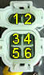
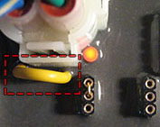

# Sensor-Anschlusspunkte Honda Transalp 600 (PD06)

> Stand: Oktober 2026
> Fahrzeug: Honda XL600V Transalp PD06 (Baujahr 1987–1999)
> Vorausgehende Dokumente: docs/HARDWARE.md, docs/PINMAP.md, docs/research/01-sensoren-fahrzeugdaten.md

---

## Inhaltsverzeichnis

1. [Übersicht](#1-uebersicht)
2. [Drehzahl (RPM) — CDI Pickup](#2-drehzahl-rpm--cdi-pickup)
3. [Öldruck](#3-oeldruck)
4. [Kühlmitteltemperatur](#4-kuehlmitteltemperatur)
5. [Kraftstoffstand](#5-kraftstoffstand)
6. [Geschwindigkeit (Tacho)](#6-geschwindigkeit-tacho)
7. [Bordspannung](#7-bordspannung)
8. [Gangposition](#8-gangposition)
9. [GPS-Antenne](#9-gps-antenne)
10. [Kabelverlegung am Motorrad](#10-kabelverlegung-am-motorrad)
11. [Quellen und Referenzen](#11-quellen-und-referenzen)

---

## 1. Übersicht

Die Honda Transalp 600 (PD06) ist ein rein mechanisches Motorrad ohne CAN-Bus,
OBD-II oder elektronische Motorsteuerung. Alle Fahrzeugdaten müssen über
direkte Sensor-Anzapfung oder eigenständige Sensoren erfasst werden.

Die folgenden Anschlusspunkte sind an der PD06 verfügbar:

| Sensor | Anzapfung | Signalart | Schwierigkeit |
|---|---|---|---|
| Drehzahl | CDI Pin 5 (Pulse Generator) | Digitales Signal (0,5–3V AC) | Mittel |
| Öldruck | Öldruckschalter am Motor | Digital (ON/OFF) oder analog (bei Sensor-Tausch) | Einfach |
| Kühlmitteltemp | Kein Geber ab Werk — Neuinstallation | Digital (DS18B20, 1-Wire) | Mittel |
| Kraftstoffstand | Tankgeber im Tank | Analog (Widerstand) | Einfach |
| Geschwindigkeit | Mechanischer Tachozug — Neuinstallation | Digital (Hall/Reed) | Mittel |
| Bordspannung | Batterie / Zündschloss | Analog (Spannungsteiler) | Einfach |
| Gangposition | Kein Geber ab Werk — optional | Analog (Spannungsteiler) | Schwer |

---

## 2. Drehzahl (RPM) — CDI Pickup

### Anschlusspunkt

Das Pickup-Signal (Pulse Generator) ist am CDI-Stecker abgreifbar.

**CDI-Stecker Pin-Belegung (PD06):**

| Pin | Farbe (typisch) | Funktion |
|---|---|---|
| 1 | Rot/Schwarz | +12V (über Zündung + Kill-Switch) |
| 2 | Grün/Gelb | Seitenständer-Überwachung |
| 3 | Schwarz/Gelb | Zündspule 1 |
| 4 | — | Zündspule 2 (nur XL650V, bei PD06 ungenutzt) |
| 5 | **Blau/Gelb** | **Pulse Generator (Pickup-Signal)** |
| 6 | Grün | Masse (Chassis) |


*CDI-Stecker Pin-Belegung (Quelle: cdi-shop.de)*


*Gelbe Draht-Brücke am CDI für PD06-Modelle ohne Seitenständer-Überwachung (Quelle: cdi-shop.de)*

> **Quelle:** cdi-shop.de — technischen Spezifikationen für PD06-CDI
> (https://cdi-shop.de/en/technical-specifications)
> Pin-Out-Bild verfügbar auf der Seite.

### Anzapfung

```
CDI Pin 5 (Blau/Gelb) ──┬── PC817 Optokoppler LED+ (Pin 1)
                         │
CDI Pin 6 (Grün/Masse) ─┴── PC817 Optokoppler LED- (Pin 2)

PC817 Ausgang (Pin 3) ── 10kΩ Pull-up auf 3,3V ── ESP32 GPIO 16 (PCNT)
PC817 Ausgang (Pin 4) ── GND
```

**Warum Optokoppler?** Das CDI-System arbeitet mit Spannungsspitzen von
200–400V an der Zündspule. Der Optokoppler sorgt für galvanische Trennung
und schützt den ESP32 vor Überspannung.

### Signal-Eigenschaften

- 1 Puls pro Kurbelwellenumdrehung
- 0,5–3V AC Peak (Pickup-Spule)
- Frequenz bei Leerlauf (~1200 rpm): 20 Hz
- Frequenz bei Maximaldrehzahl (~8000 rpm): 133 Hz

### Alternative Anzapfung

Am 2-poligen Pickup-Sensor-Stecker unter dem Kraftstofftank (laut HealTech
QSH-CKP Installationsanleitung). Die beiden Drähte des CKP (Crankshaft
Position Sensor) können hier direkt abgegriffen werden.

> **Quelle:** HealTech QSH-CKP Installationsanleitung
> (https://healtech-electronics.com/docs/QSH-CKP_InstallGuide_en.pdf)

### Berechnung

```
RPM = (Pulse im Messfenster) × 60 / (Messfenster_s × PULSES_PER_REV)
```

Bei 1 Puls/Umdrehung: `RPM = Pulse × 60 / Messfenster_s`

Die Firmware verwendet PCNT (Pulse Counter) mit 100ms Messfenster → 10Hz Update-Rate.

---

## 3. Öldruck

### Anschlusspunkt

Der Öldruckschalter befindet sich **vorne rechts unten am Kurbelgehäuse**,
in der Nähe der Ölpumpe.

**Ab Werk:** Einfacher Schalter (ON/OFF)
- Geschlossen bei ausreichend Öldruck (> ~0,3 bar)
- Öffnet bei Öldruckabfall → Kontrollleuchte

**Teilenummer:** A4795 (Motorradteile Hannover)
**Ersatzteil:** "Honda XL 600 PD06 Transalp Öldruckschalter" (~17 USD, Marktplatz)

### Variante A: Digital (nur Warnung)

Parallel zum vorhandenen Schalter anklemmen:

```
12V (geschaltet) ──┬── Öldruckschalter ──┬── ESP32 GPIO 17 (mit Pull-down)
                    │                      │
                    └── 10kΩ Pull-up ──────┘
```

- Schalter geschlossen (Öldruck OK) → GPIO LOW
- Schalter offen (Öldruck kritisch) → GPIO HIGH → Warnung

### Variante B: Analog (0–5 bar Messung)

Originalschalter durch analogen Öldrucksensor ersetzen:

- **Analoger Öldrucksensor 0–5 bar** (M10x1 Gewinde, 10–180 Ohm)
- 25,00 EUR (siehe BOM)
- Montage an der originalen Gewindebohrung am Kurbelgehäuse

```
3,3V ──┬── Öldrucksensor (10–180Ω) ──┬── GND
       │                           │
       └── 10kΩ ──────────────────┴── ESP32 ADC1_CH0 (GPIO 1)
```

> **Achtung:** Beim Tausch des Öldruckschalters gegen einen analogen Sensor
> entfällt die originale Öldruck-Warnleuchte. Falls diese erhalten bleiben
> soll, kann ein T-Stück am Gewinde montiert werden, das beide Sensoren
> aufnimmt.

### Quellen

- Marktplatz: https://www.ebay.com/itm/375443851545
- Motorradteile Hannover: https://motorradteilehannover.de/
- Service Manual: Seite 9-1 (Electrical System)

---

## 4. Kühlmitteltemperatur

### Anschlusspunkt

Die PD06 hat **ab Werk keinen elektronischen Temperaturgeber**. Es gibt
nur einen Thermoschalter für die Kühlerventilatoren (auf/zu, nicht analog).

### Lösung: DS18B20 nachrüsten

**Sensor:** DS18B20 wasserdicht, Edelstahlrohr, 1-Wire, ±0,5°C, -55 bis +125°C
**Preis:** 3,00 EUR (siehe BOM)

#### Montageoptionen

| Option | Beschreibung | Vorteil | Nachteil |
|---|---|---|---|
| **T-Stück im Kühlerschlauch** | Kühlmittel-Schlauch durchtrennen, T-Stück mit Sensor einfügen | Direkte Kühlmitteltemperatur | Schlauch muss durchtrennt werden |
| **Adapter am Thermostat** | Gewinde-Adapter am Thermostatgehäuse | Original, sauber | Adapter anfertigen |
| **Oberflächensensor** | DS18B20 mit Wärmeleitpaste am Kühlerschlauch kleben | Kein Eingriff ins Kühlsystem | Weniger genau (~2–5°C Offset) |

**Empfehlung:** T-Stück im oberen Kühlerschlauch (heißer Rücklauf vom Motor).

#### Verdrahtung

```
3,3V ──┬── DS18B20 VCC (rot)
       │
       └── 4,7kΩ Pull-up ──┬── DS18B20 Data (gelb) ── ESP32 GPIO 15
                            │
GND ────────────────────────┴── DS18B20 GND (schwarz)
```

> **Quelle:** Louis Motorradteildatenbank für PD06
> (https://www.louis.eu/en/bike-database/honda-xl-600-v-transalp/pd06/0281)

---

## 5. Kraftstoffstand

### Anschlusspunkt

Der Tankgeber sitzt **im Kraftstofftank** und ist über ein Kabel erreichbar,
das unter dem Tank / an der Tankhalterung herausführt.

**Ab Werk:** Widerstandsgeber für die Tankleuchte (Reserve-Warnung)

### Anzapfung

Am Geber-Kabel abgreifen (ohne den Originalstromkreis zu stören):

```
Tankgeber-Signal ──┬── 10kΩ ──┬── ESP32 ADC1_CH3 (GPIO 4)
                   │          │
3,3V ─────────────┴── 10kΩ ──┴── MCP6001 OpAmp (Impedanzwandlung)
```

Der MCP6001 Operationsverstärker wandelt den hochohmigen Widerstandsgeber
in ein sauberes, niederohmiges Signal für den ADC.

### Kalibrierung

| Widerstand | Kraftstoffstand | ADC-Wert |
|---|---|---|
| 10 Ω (leer) | 0% (Reserve) | ~0 |
| 90 Ω (voll) | 100% | ~4095 |

Die genauen Widerstandswerte müssen am Motorrad gemessen werden (variiert
je nach Baujahr und Geber-Version). Die Firmware unterstützt eine
Kalibrierung über die Companion-App.

---

## 6. Geschwindigkeit (Tacho)

### Anschlusspunkt

Die PD06 hat einen **mechanischen Tachozug** vom Vorderrad. Es gibt kein
elektronisches Tacho-Signal, das abgegriffen werden kann.

### Lösung: Hall-Sensor am Vorderrad

**Sensor:** A3144 Unipolar Hall-Sensor + Neodym-Magnet 5mm
**Preis:** 2,00 EUR (siehe BOM)

#### Montage

1. **Magnet** an einer Speiche oder an der Bremsscheibe befestigen
   (mit Schrumpfschlauch + Kabelbinder oder Kleber)
2. **Hall-Sensor** am Gabelholm fixieren, 3–5mm Abstand zum Magnet
3. Kabel am Gabelholm hochführen, unter der Verkleidung zum Bordcomputer

#### Verdrahtung

```
5V ──── A3144 VCC
GND ─── A3144 GND
A3144 OUT ──┬── 10kΩ Pull-up auf 3,3V ── ESP32 GPIO 18 (PCNT Unit 1)
            │
            └── GND (durch Sensor bei Magnetfeld)
```

#### Berechnung

```
Geschwindigkeit = (Pulse/s) × Radumfang × 3,6 / Pulses_per_Revolution
```

- Radumfang PD06: ~2,07m (110/80-19 Reifen)
- 1 Puls pro Radumdrehung (1 Magnet)
- Bei 100 km/h: ~13,4 Hz

### Alternative: GPS-Geschwindigkeit

Falls der Hall-Sensor entfallen soll, kann die Geschwindigkeit aus dem
GPS-Modul (NEO-M9N) abgeleitet werden. Genauigkeit: ±0,1 km/h bei 10Hz
Update-Rate. Nachteil: Funktioniert nur mit GPS-Empfang.

---

## 7. Bordspannung

### Anschlusspunkt

Direkt an der Batterie ( permanent) oder am Zündschloss (geschaltet).

### Anzapfung

```
Batterie + (12V) ── 100kΩ ──┬── 33kΩ ── GND
                             │
                             └── ESP32 ADC1_CH7 (GPIO 6)
```

Spannungsteiler 100k/33k:
- 12V → 2,98V am ADC (im 0–3,3V Bereich)
- 15V → 3,72V (über Bereich — Zener-Diode 3,3V als Schutz)
- Maximal messbar: 16,5V (3,3V × (100+33)/33)

Die Firmware glättet den ADC-Wert mit gleitendem Mittelwert und berechnet:

```
Bordspannung = ADC_Wert × 3,3 × (100+33) / (33 × 4095)
```

### TVS-Schutz

Eine SMAJ15A TVS-Diode am ADC-Eingang schützt gegen Lastabwurf-Spitzen
(Load Dump), die beim Motorrad besonders stark auftreten können.

---

## 8. Gangposition (optional)

### Anschlusspunkt

Die PD06 hat **ab Werk keinen Gangpositionssensor**. Eine
Gangerkennung ist nur indirekt möglich:

#### Option A: Berechnung aus RPM und Geschwindigkeit

```
Übersetzung = (RPM × Radumfang) / (Geschwindigkeit × 60 × 3,6)
```

Die Firmware ordnet den Übersetzungswert den 5 Gängen zu (Kalibrierung
bei bekannter Gangstellung).

#### Option B: Mikroschalter am Schaltgestänge

Ein Magnetreedschalter oder Hall-Sensor am Schaltgestänge erkennt
Schaltvorgänge. Die Firmware zählt die Gänge hoch/runter.

- Vorteil: Kein Eingriff ins Getriebe
- Nachteil: Muss bei jedem Motorstart synchronisiert werden (Neutralpunkt)

---

## 9. GPS-Antenne

### Montageort

| Position | Empfehlung | Begründung |
|---|---|---|
| Unter Sitzbank | Bedingt | Metallrahmen kann Empfang stören |
| Auf dem Tank (unter Abdeckung) | Gut | Freie Sicht zum Himmel |
| Lenkerende (außen) | Sehr gut | Höchste Position, freie Sicht |
| Unter Verkleidung | Schlecht | Abschirmung durch Kunststoff OK, aber Metall blockiert |

**Empfehlung:** Auf dem Tank oder am Lenkerende, mit Magnetfuß auf
einer Metallfläche. Antennenkabel unter Verkleidung zum Bordcomputer
führen.

### Kabel

Das Active-Patch-Antennenkabel (1,5m) reicht vom Tank bis unter die
Sitzbank (Bordcomputer-Montageort).

---

## 10. Kabelverlegung am Motorrad

### Routenplanung

```
Vorderrad (Hall-Sensor)
    │
    ├─ am linken Gabelholm hoch
    ├─ unter Lenker-Abdeckung
    ├─ hinter Tankverkleidung
    │
Tankgeber ─────────────────┤
    │                       │
    ├─ am Tankrahmen        │
    │                       │
Kühlmittel (DS18B20) ──────┤
    │                       │
    ├─ am Kühlerschlauch    │
    │                       │
CDI (Pickup Pin 5) ────────┤
    │                       │
    ├─ am CDI-Stecker       │
    │   unter Sitz           │
    │                       │
Batterie (12V) ────────────┤
    │                       │
    └─ an Batterieklemme    │
                            │
                    ┌───────┴───────┐
                    │  Bordcomputer  │
                    │  (unter Sitz)  │
                    └───────────────┘
```

### Kabelschutz

- **Kabelbinder** (UV-beständig, 100mm) alle 10–15cm an vorhandenen
  Rahmenrohren
- **Schrumpfschlauch** an exponierten Stellen (Stecker, Übergänge)
- **Klappferritkerne** an jedem Sensor-Kabel (EMV-Schutz, nah am Bordcomputer)
- **Abgeschirmtes Kabel** (4-adrig, S/UTP) für analoge Sensoren
- **PG7/PG9 Kabelverschraubungen** (IP67) am Gehäuseeintritt

### Kabelquerschnitte

| Einsatz | Querschnitt | Farbe |
|---|---|---|
| 12V Bordnetz | AWG20 (0,5mm²) | Rot |
| Masse | AWG20 (0,5mm²) | Schwarz |
| Sensorsignale | AWG24 (0,2mm²) | Verschieden |
| Display-Verbindung | FPC / Flachbandkabel | — |

### Stecker-Belegung

| Sensor | Stecker | Polig | IP-Schutz |
|---|---|---|---|
| 12V Bordnetz | AMP Superseal | 2 | IP67 |
| ADC-Sensoren (Temp, Fuel, Oil) | AMP Superseal | 3 | IP67 |
| Relais-Steuerung | AMP Superseal | 4 | IP67 |
| GPS | JST-SM | 4 | IP65 |

---

## 11. Quellen und Referenzen

### Service Manual

- Honda XL600/650V Transalp & XRV750 Africa Twin Service Manual (1987–2007)
  - **URL:** https://www.moto4.ru/downloads/Service_Repare_Manual_Honda_XL600_650V_Transalp_XRV750_AfricaTwin_87_07_st_font_fin.pdf
  - Wiring Diagrams: Seite 9-34
  - Electrical System: Seite 9-1
  - Component Locations: Seite 9-25

### CDI Pin-Out

- CDI-Shop (spezifisch für PD06)
  - **URL:** https://cdi-shop.de/en/technical-specifications
  - Enthält Pin-Belegung mit Bild für XL600V PD06
  - Pin 5 = Pulse Generator (Pickup-Signal)

### Pickup-Sensor Anzapfung

- HealTech QSH-CKP Installationsanleitung
  - **URL:** https://healtech-electronics.com/docs/QSH-CKP_InstallGuide_en.pdf
  - Beschreibt Anzapfung am CKP-Stecker unter dem Tank

### Öldruckschalter

- Marktplatz: https://www.ebay.com/itm/375443851545
- Motorradteile Hannover: https://motorradteilehannover.de/

### Kühlmitteltemperatur

- Louis Motorradteildatenbank PD06:
  - https://www.louis.eu/en/bike-database/honda-xl-600-v-transalp/pd06/0281

### Ersatzteile und Schematics

- CMSNL (Teilelisten und Schematics für PD06 1994):
  - https://www.cmsnl.com/honda-xl600v-transalp-1994-r-germany_model6578/partslist
- Hamart.at (Ersatzteile PD06):
  - https://www.hamart.at/shopG/?cPath=259_1059

### Fahrerhandbuch

- Honda Fahrerhandbuch XL600V Transalp:
  - https://www.honda.de/content/dam/local/germany/motorcycles/pdf/service/fahrerhandbuecher/XL600V_Transalp_37MAW600.pdf

### Foren und Community

- Transalp-Freunde Deutschland e.V.:
  - https://forenarchiv.transalp.de/
- ADV Rider (englischsprachig):
  - https://advrider.com/f/threads/hawk-gt650-engine-in-a-pd06-transalp.1774187
- Transalp Owners Forum:
  - https://www.transalpowners.com/

### Externe Bildquellen (mit direkten Links)

Die folgenden externen Quellen enthalten Originalfotos und Schematics der
Anschlusspunkte an der PD06. Da diese Bilder urheberrechtlich geschützt
sind, werden sie hier verlinkt und nicht im Repo gespeichert.

| Was | Quelle | URL |
|---|---|---|
| **CDI-Stecker Pin-Out** (Foto der Steckerbelegung) | cdi-shop.de | https://cdi-shop.de/images/pins.jpg |
| **CDI Wire Jumper** (gelbe Drahtbrücke, Foto) | cdi-shop.de | https://cdi-shop.de/images/gelber-draht.jpg |
| **CDI-Unit Foto** (Originalteil 30410-MS8-610) | KFM-Motorräder | https://kfm-motorraeder.de/en/item/honda-30410MS8610 |
| **CDI-Unit Foto** (mit Halterung) | KFM-Motorräder | https://kfm-motorraeder.de/en/item/honda-30410MS8610 |
| **Öldruckschalter** (Originalteil A4795) | Motorradteile Hannover | https://motorradteilehannover.de/Honda-XL-600-V-Transalp-PD06-Bj-1993-oil-pressure-switch-oil-level-sensor-A4795 |
| **Öldruckschalter** (Marktplatz, mit Foto am Motor) | Marktplatz | https://www.ebay.com/itm/375443851545 |
| **Wasserpumpe + Dichtung** (Einbauposition Kühlmittel) | mcjoys.dk | https://mcjoys.dk/index.php/goods/Water-Pump-Gasket-Set-Transalp-600V-XL600V-PD06/1340203 |
| **Thermostat** (Originalteil 19300-KE8-000) | lavieenfrance.net | https://www.lavieenfrance.net/XL-600V-Transalp-PD06-PD10-1987-2000-Japan-OE-1009355 |
| **Teilelisten und Schematics** (alle Baugruppen) | CMSNL | https://www.cmsnl.com/honda-xl600v-transalp-1994-r-germany_model6578/partslist |
| **Kühlmittel-Ablassschraube** (Einbauposition Motorblock) | Honda TechInfo | https://techinfo.honda.com/rjanisis/pubs/OM/OD0101/OD0101O00255A.pdf |
| **Service Manual** (komplettes Werkstatthandbuch) | moto4.ru | https://www.moto4.ru/downloads/Service_Repare_Manual_Honda_XL600_650V_Transalp_XRV750_AfricaTwin_87_07_st_font_fin.pdf |
| **Service Manual** (OCR-Volltext, durchsuchbar) | 4-stroke.net | https://4-stroke.net/documents/workshopmanual_xl600_transalp_en_1987-2002_21062017-1026-ocr_text.txt |
| **Fahrerhandbuch** (XL600V, deutsch/englisch/französisch) | honda.de | https://www.honda.de/content/dam/local/germany/motorcycles/pdf/service/fahrerhandbuecher/XL600V_Transalp_37MAW600.pdf |
| **CDI Known Problems** (Sitz-Druck auf CDI, Halterung) | transalp.ta-deti.de | http://transalp.ta-deti.de/knownproblems.html |
| **CDI-Diskussion** (ADV Rider Forum, mit Fotos) | advrider.com | https://advrider.com/f/threads/show-us-your-transalp-modifications.39170/ |
| **HealTech QSH-CKP** (Pickup-Anzapfung Anleitung) | HealTech | https://healtech-electronics.com/docs/QSH-CKP_InstallGuide_en.pdf |
| **Ersatzteile PD06** (kompletter Katalog) | Hamart.at | https://www.hamart.at/shopG/?cPath=259_1059 |
| **Louis Teiledatenbank** (PD06-spezifisch) | Louis | https://www.louis.eu/en/bike-database/honda-xl-600-v-transalp/pd06/0281 |

---

## Anhang: Schnellreferenz Pin-Map

| Sensor | ESP32 GPIO | Interface | Pin am Bordcomputer |
|---|---|---|---|
| RPM (CDI Pickup) | GPIO 16 | PCNT Unit 0 | J1-1 |
| Öldruck (analog) | GPIO 1 (ADC1_CH0) | ADC | J1-2 |
| Öldruck (digital) | GPIO 17 | GPIO | J1-3 |
| Kühlmitteltemp (DS18B20) | GPIO 15 | 1-Wire | J1-4 |
| Kraftstoffstand | GPIO 4 (ADC1_CH3) | ADC | J1-5 |
| Geschwindigkeit (Hall) | GPIO 18 | PCNT Unit 1 | J1-6 |
| Bordspannung | GPIO 6 (ADC1_CH7) | ADC | J1-7 |
| IMU (BMI270) | GPIO 8/9 | I2C | J2-1/2 |
| Barometer (BMP390) | GPIO 8/9 | I2C | J2-1/2 |
| GPS (NEO-M9N) | GPIO 43/44 | UART | J2-3/4 |
| Display (TFT) | GPIO 35–48 | RGB Parallel | FPC-1 |
| SD-Karte | GPIO 11–14 | SPI | J3-1 |
| BLE | Intern | — | — |
| Relais-Steuerung | GPIO 21–25 | GPIO | J4-1 bis J4-4 |

> Detaillierte Pin-Belegung siehe [PINMAP.md](PINMAP.md).
